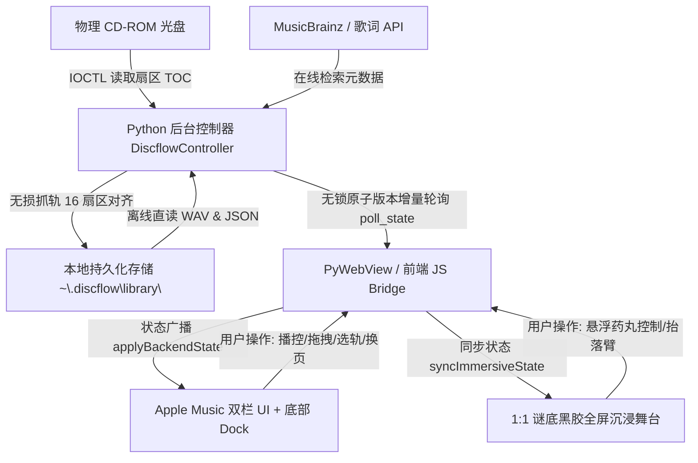

# Discflow 产品需求文档 (Product Requirements Document, PRD)

**版本号**：v2.0.0 (Final — Cleanup & Polish)  
**创建时间**：2026-11-01  
**最后更新**：2026-11-02  
**状态**：已冻结基线 (Approved Baseline)  
**适用对象**：产品经理、前端开发工程师、底层音频/硬件开发工程师、测试工程师  

---

## 1. 产品目标、核心定位与目标使用场景

### 1.1 产品愿景与核心定位
**Discflow** 是一款专为 Windows 平台打造的 **现代极简、拟物高保真 CD 音乐播放器与数字黑胶唱片资料库**。  
它融合了：
1. **Apple Music** 原生桌面端双栏工作台架构（侧边栏导航 + 主视口多页面瞬时切换 + 底部常驻微播控 Dock 栏）；
2. **谜底黑胶（MD Vinyl）** 1:1 像素级全屏沉浸播放拟物仪式感（左硬纸板封套 + 右侧半露定制流纹黑胶 + 右上方亚克力悬浮底座金属机械唱臂落臂/抬臂 + 底部通透毛玻璃胶囊药丸 Dock）；
3. **零损 CD-DA 44.1kHz / 16-Bit 原生硬件直读驱动** 与 **防静音安全抓轨无损转录归档引擎**。

### 1.2 目标用户群体
- **物理 CD 音乐发烧友**：拥有大量正版实体音频光盘，追求原盘无损直读输出，厌恶传统播放器臃肿丑陋的复古界面；
- **黑胶/拟物美学爱好者**：偏爱唱片旋转、机械唱针落臂、流光各向异性反光及抽盘转场微交互等仪式感；
- **数字档案整理用户**：希望使用外置或内置光驱将 CD 音轨零损抓轨到本地免光驱播放，且要求封面、专辑信息与双语同步歌词持久化保存。

### 1.3 目标使用场景
- **桌面常驻听歌伴随**：利用 Apple Music 双栏架构在后台或一侧窗口安静播放，底部常驻 Dock 随时掌控播放与切曲；
- **全屏沉浸专注倾听**：在夜晚或休闲时一键展开全屏沉浸舞台（ESC 退出），将屏幕变为高颜值拟物动态黑胶唱机与时钟桌面；
- **零损快速转录归档**：放入新购入的光盘，点击抓轨归档至 4 列黑胶货架资料库，拔出光驱即可免盘离线回放。

---

## 2. 整体页面布局架构与导航逻辑

软件采用三层视觉结构：**最底层柔焦流体环境光背景**、**中层主应用双栏骨架**、**顶层 1:1 谜底黑胶全屏沉浸大舞台与弹窗浮层**。

```
+-----------------------------------------------------------------------------------------+
| [Discflow 图标] 驱动器下拉 [读盘] [弹出] 状态提示          [沉浸黑胶] [功能菜单] [外观设置] | (Top Bar)
+-------------------+---------------------------------------------------------------------+
| 资源库            | [主视口 Viewport]                                                    |
| - 正在播放 (CD)    |   1. #viewCd: 左封面/进度/三模式 + 右柔焦双语歌词/音轨列表              |
| - 黑胶资料库 (4列) |   2. #viewLibrary: 4 列精致货架黑胶卡片 (封套+半露黑胶+抽盘交互)        |
| - 双语歌词 (全屏)  |   3. #viewLyrics: 居中纯享大号卡拉OK滚动歌词视口                         |
| 快捷入口          |                                                                     |
| - 无损抓轨归档    |                                                                     |
| - 全屏沉浸舞台    |                                                                     |
+-------------------+---------------------------------------------------------------------+
| [封面缩略图 曲名]  |     [上一曲]  [ 播放/暂停 ]  [下一曲]      | 模式切换 [音量条] [沉浸图标] | (Bottom Dock)
| [歌手名 - 耗时]   |  0:00 [======= 进度滑块 =======] -3:24    |                                     |
+-----------------------------------------------------------------------------------------+
```

### 2.1 顶部统一操作栏 (Top Bar)
- **左侧硬件集群**：
  - `discflow-brand`：品牌徽标 + 极简黑白 SVG 矢量图标 + 绿字“沉浸黑胶”标签，点击直接呼出全屏沉浸黑胶大舞台；
  - `statusDot`：硬件状态呼吸指示灯（绿色正常就绪，黄色扫描中，红色离线）；
  - `driveSelect`：自动列出系统中所有可用物理 CD-ROM 盘符（如 `D:\`, `E:\`）；
  - `rescanDrive` 读盘按钮：重新读取 TOC 目录扇区与 CD-Text；
  - `ejectDrive` 弹出按钮：安全弹出光驱硬件托盘；
  - `statusText`：文字状态跑马灯或实时状态反馈。
- **右侧功能集群**：
  - `沉浸黑胶` Pill 按钮：进入全屏谜底黑胶沉浸舞台；
  - `菜单` 按钮：唤出毛玻璃控制菜单（抓轨、重扫、弹盘、关于等）；
  - `外观设置` 按钮：深浅外观切换、双语翻译开关、自动播放设置。

### 2.2 macOS 双栏工作台体系 (Sidebar + Viewport)
- **左侧导航栏 (`.app-sidebar`)**：
  - **分类导航项**：
    - `正在播放 (CD)`（`#sideNavCd`）：激活 `#viewCd`；
    - `黑胶资料库`（`#sideNavLibrary`）：激活 `#viewLibrary`；
    - `双语歌词`（`#sideNavLyrics`）：激活 `#viewLyrics`。
  - **底部动作项**：
    - `无损抓轨归档`：启动当前 CD 音轨抓轨模态对话框；
    - `全屏沉浸舞台`：一键全屏展开谜底黑胶播放大舞台。
- **右侧主视口 (`.app-viewport`)**：
  - 承载 `view-page` 容器，通过 `switchMainView(viewName)` 实行无缝无刷新切换。

### 2.3 底部常驻微播控 Dock 栏 (`.bottom-dock-player`)
- 无论用户切至资料库还是歌词视口，底部播控栏始终常驻：
  - **左区**：封面微缩图、歌曲名、艺术家名（点击平滑回切至当前曲目播放页）；
  - **中区**：精致时间滑块（支持拖拽定位 Seek）、核心播放/暂停、上一曲/下一曲按键；
  - **右区**：顺序/随机/单曲播放模式轮转、音量条拖拽调节、全屏沉浸黑胶快捷图标。

### 2.4 全屏沉浸黑胶播放模式 (MD Vinyl 1:1 Stage)
- 独立全屏悬浮顶层（`#immersiveVinylStage`，`z-index: 100`），支持随时按下键盘 `ESC` 键或右上角 `✕` 退出：
  - **顶部**：左侧极简时钟（格式：`16:39 9月7日 週一`），右侧设置与折叠按钮；
  - **中心大舞台**：左侧硬纸板封套 + 右侧半抽出匀速自转定制黑胶 + 右上方亚克力悬浮透明底座与金属细臂机械唱臂（拟物落臂/抬臂）；
  - **底部悬浮药丸胶囊**：高透毛玻璃液体药丸 Dock（曲目、封面圆标、三态播控与模式）。

---

## 3. 各模块功能点、字段定义与操作流程

### 3.1 实体 CD-DA 播放模块 (`#viewCd`)
#### 功能点
1. **自动识别与免驱读盘**：插入光盘后由底层异步检测并读取 TOC 扇区表与 CD-Text；
2. **多源元数据检索**：优先命中 CD-Text，若无则使用 DiscID 请求 MusicBrainz / FreeDB 获取专辑、曲目名、发行年份与高清封面；
3. **WinMM 双缓冲原生直读回放**：以 44.1kHz 16-Bit 立体声零转换直接输送到 Windows 音频总线；
4. **右侧面板切换**：支持在“双语滚动歌词”与“CD 音轨列表”间无缝折叠切换。

#### 字段与状态定义
- `drive`: `str`（如 `"D:"`）
- `current_track_index`: `int`（从 0 开始）
- `elapsed_sec`: `float`（当前播放秒数）
- `duration_sec`: `float`（曲目总秒数）
- `isPlaying`: `bool`（播放态）
- `play_mode`: `"order" | "shuffle" | "one"`

#### 核心操作流程
1. 插入光盘 -> `statusDot` 变黄闪烁 -> 解析 TOC -> 匹配元数据 -> 自动起播第一首（若开启自动播放）；
2. 拖拽 `scrubberHit` 滑块 -> 触发 `seek_to(sec)` -> 底层扇区 LBA 偏移并清空缓冲区重刷 -> 恢复实时回放。

---

### 3.2 本地黑胶资料库模块 (`#viewLibrary`)
#### 功能点
1. **精致 4 列黑胶货架陈列**：标准化网格展示（`grid-template-columns: repeat(4, 1fr)`），卡片包含封套前页、露出 38% 的带有同心微沟槽与圆标的黑胶碟片；
2. **物理级抽盘微交互**：点击卡片时，黑胶碟片向右上角弹簧阻尼滑出（`translateX(85px) translateY(-22px) rotate(75deg)`），460ms 后资料库平滑淡出，无缝直达沉浸黑胶舞台起播；
3. **免光驱无损播放**：读取本地高保真 WAV 音频流，直接驱动底层播放器，不受物理光驱状态影响；
4. **单张唱片管理与删除**：卡片右下角提供轻量删除按钮，二次确认后安全移除本地音频与数据文件。

#### 资料库数据模型定义 (`album.json`)
```json
{
  "disc_id": "9pdR4R7U1bXqBrQh_8QkhO9arQI-",
  "title": "专辑名称",
  "artist": "艺术家名称",
  "year": "2024",
  "cover_file": "cover.jpg",
  "cover_data_url": "data:image/jpeg;base64,...",
  "ripped_at": 1793462994.08,
  "total_duration_sec": 2480.5,
  "tracks": [
    {
      "track_number": 1,
      "title": "Track 01",
      "artist": "艺术家名称",
      "duration_sec": 234.1,
      "file_name": "track_01.wav",
      "lyrics": [
        {"time": 12.5, "text": "歌词正文", "trans": "双语翻译"}
      ]
    }
  ]
}
```

---

### 3.3 无损抓轨归档模块 (`#ripModal`)
#### 功能点
1. **严格 16 扇区安全缓冲区传输**：
   - 规定单次抓取扇区为 16（36,864 字节 ≤ 64KB USB 限制），杜绝 Windows 底层填充全 0 静音空白文件；
2. **单扇区降级与容错**：遇到物理光盘瑕疵时自动逐一单扇区重试，失败立即向 UI 报送错误并安全终止；
3. **硬件互斥**：在抓轨开始瞬间强制暂停播放器并释放句柄，防止双重访问总线冲突；
4. **实时双进度反馈**：总进度条（绿色）+ 当前音轨进度条（白色）双向联动。

---

### 3.4 1:1 谜底黑胶（MD Vinyl）沉浸大舞台 (`#immersiveVinylStage`)
#### 功能点
1. **左封套 + 右流纹黑胶经典构图**：
   - 左侧封套具备真实硬质折痕高光与景深投影；
   - 右侧半露黑胶具备精细微沟槽、扇形各向异性反光与中心纸标；随音乐播放同心圆平滑旋转（20s/周），暂停时平缓刹停。
2. **右上方亚克力悬浮机械唱臂**：
   - 圆角矩形高透磨砂亚克力底座 + 双层金属同心转轴 + 细臂管 + 斜角黑色拾音唱头与唱针；
   - 播放时旋转落臂至黑胶外缘（`26deg`），暂停/切歌时平缓抬臂复位。
3. **底部通透悬浮药丸胶囊 Dock**：
   - 内部集成队列按钮、微缩唱片圆标、曲名/歌手、拟物播放/暂停及模式轮转；
   - 左右两侧悬浮毛玻璃圆形辅助键（左返回资料库，右展开双语歌词）。

---

## 4. 各模块数据流转与联动体系



1. **增量版本号（Meta Version & Lyrics Version）驱动**：
   - 前端每 150ms 发起轻量增量轮询 `poll_state(metaVer, lyricsVer)`；
   - 仅当版本号变更时才传输大型数据（Base64 封面、完整音轨队列与歌词字典），毫秒级极速响应，消除线程阻塞；
2. **主界面与底部 Dock 强联动**：
   - 无论处于物理 CD 页面还是本地资料库页面，底部 Dock 始终保持与当前底层音频时钟和曲目信息 100% 同步；
3. **资料库切歌向沉浸模式无缝流转**：
   - 点击资料库唱片 -> 触发 `playLocalAlbumWithAnimation` -> 触发抽盘动效 -> 调用 `play_local_album` -> 广播状态 -> 资料库淡出 -> 沉浸大舞台展开并开始匀速自转与落臂。

---

## 5. 数据持久化、自动保存、手动备份与恢复体系

为确保程序重启、操作系统升级或用户清理系统缓存后**数据绝对不丢失**，建立以下规范：

### 5.1 本地首选持久化存储规范
- **基准路径**：`~/.discflow/`（对应 Windows 下的 `C:\Users\<Username>\.discflow\`）
  - `~/.discflow/library/`：存储所有抓轨生成的黑胶专辑。每个专辑以其唯一的 `disc_id` 命名独立文件夹，包含：
    - `album.json`：专辑元数据、音轨详情与内联歌词数据；
    - `cover.jpg`：高清原始封面图像；
    - `track_01.wav`, `track_02.wav`, ...：高保真 WAV 音频文件。
  - `~/.discflow/config.json`：存储用户个性化配置（深浅外观模式、双语歌词开关、自动播放偏好、上一次音量等）。
- **非易失性保障**：严禁将资料库存储在 `%TEMP%`、浏览器的临时缓存（IndexedDB/LocalStorage）或随时可能被系统清理工具删除的虚拟路径中。

### 5.2 自动保存机制 (Auto-Save)
1. **设置自动保存**：用户在外观设置或主界面切换深浅外观、调整音量或改变双语歌词状态时，配置立即持久化写入 `config.json`；
2. **抓轨即时归档**：抓轨引擎转录完成一张光盘并校验成功后，立即将元数据与音频文件原子写入资料库，无需用户手动保存；
3. **缓存容灾保护**：若网络离线，优先从本地已缓存的专辑信息与歌词中直读，保证断网环境下资料库依然完全可用。

### 5.3 外部介质备份与一键同步 (External Backup & Mirror)
- **多磁盘热备归档**：
  - 项目在构建与同步流水线中已配置向独立外部驱动器（如 `E:\Discflow`）进行全量镜像同步（使用 `robocopy /E /XD .git build`）；
- **资料库手动导出/备份协议**：
  - 用户只需拷贝 `~/.discflow/library` 目录或直接备份整个文件夹，即可在任意新的 Windows 电脑上恢复所有专辑与曲目；
- **自愈式扫描加载 (Self-Healing Catalog)**：
  - 启动时自动遍历 `library/` 目录下所有包含有效 `album.json` 的子文件夹。若检测到文件存在，立刻自动建库上架，杜绝因单张唱片损坏导致全局崩溃。

---

## 6. 质量、性能与验收标准

1. **音频输出真实性**：
   - 物理 CD 与资料库播放均通过底层 WinMM 音频通道发声；
   - 抓轨必须经过首帧 PCM 非零探测，杜绝任何全 0 空白静音文件。
2. **动效流畅度**：
   - 抽盘过渡动效、黑胶同心旋转、唱臂机械落臂与抬臂在主流核显及独立显卡上均稳定在 60 FPS，无丢帧、撕裂或卡顿。
3. **自适应与稳定性**：
   - 窗口尺寸在 `1120x740` 标准分辨率下完美呈现，超小窗口做自适应布局保护；
   - 物理光驱热插拔或光盘弹出时，播放器优雅停止并重置状态，无句柄泄露与崩溃报错。


---

## 7. 第二版二次开发与视觉交互重构（v1.2 规范变更）

针对第一版使用反馈，项目完成了深度交互重构与视觉精简，代码已全量实施并自动化验证：

### 7.1 顶部栏精简与重构
1. **精简文案收敛为纯图标**：
   - 彻底移除顶部栏中“沉浸黑胶”、“Discflow”等冗余臃肿的文字标签。
   - 左侧品牌与右侧功能入口全部收敛为精致高质感纯 SVG 图标，点击左侧品牌图标呼出关于信息，右侧汉堡图标呼出综合设置菜单（外观设置、主题切换等系统配置）。
2. **光驱状态与控制**：
   - 隐藏手动下拉框，保留「读盘」与「弹出」原生极简胶囊按钮。
   - 保留柔和呼吸绿色发光脉冲指示灯（`statusDotPulse`），直观反映光驱读写与空闲状态。

### 7.2 界面布局与视觉规范（左右极简双栏 + 悬浮控制栏）
1. **常规播放界面极简双栏**：
   - 消除播放区域厚重生硬边框与多余背景层（`border: none; background: transparent;`）。
   - 界面主体专注于左右极简双栏：左侧固定展示大尺寸专辑封面与元数据，右侧专注于流式双语歌词滚动展示。
2. **底部悬浮控制栏（`.bottom-dock-player`）重构**：
   - 彻底移除侧边栏及冗余文字区域（“正在播放”、“黑胶资料库”、“双语歌词”、“全屏沉浸舞台”、“无损抓轨归档”）。
   - 将「抓轨」、「曲目」、「音量」、「沉浸黑胶」全部以纯图标形式收拢于底部控制栏右侧。
   - 采用半透明毛玻璃（Backdrop Blur，40px）与微光细腻边框（`border: 1px solid rgba(255, 255, 255, 0.14)`），增强层次与光泽感。
   - 浮动于播放区域上方（`position: absolute; bottom: 22px;`），水平定位严格锚定在左侧封面右侧（`left: calc(var(--left-col-max) + 24px); right: 24px;`），可覆盖歌词内容，但**严禁遮挡左侧专辑封面**。

### 7.3 资料库检索与路由交互
1. **路由逻辑修复**：
   - 修复点击资料库专辑直接跳至沉浸黑胶的异常，改为默认平滑导航至常规播放界面（`switchMainView('cd')`），并确保关闭沉浸全屏状态。
2. **检索交互优化**：
   - 资料库搜索入口改为纯图标，固定排布在资料库最右侧竖排功能区（`library-vertical-toolbar`）。
   - 点击纯放大镜搜索图标后，采用 iOS 物理阻尼曲线平滑展开文本输入框（`width: 0 -> 220px`），支持毫秒级实时过滤专辑名称与艺术家，附带一键清空按钮，再次点击平滑反向折叠。

### 7.4 沉浸黑胶模式深度重构与动效开发
1. **背景与唱片动态取色**：
   - 沉浸全屏背景渐变（`--ambient-primary`, `--ambient-secondary`）与彩胶（Colored Vinyl）盘面颜色（`--vinyl-tint-highlight`, `--vinyl-tint-dark`）均提取自当前专辑封面主色，换歌时自适应动态流光过渡。
2. **唱针定位修复防漂移**：
   - 重构封套、黑胶盘与机械唱臂坐标体系，以舞台与黑胶盘为恒定几何约束基准，彻底消除因视口宽高比（vw/vh）变化导致的相对位移漂移，各缩放比例下唱针均精准锚定在盘面右侧音轨沟槽上。
3. **界面去干扰**：
   - 移除沉浸模式顶部的时间日期、综合设置按钮及关闭（叉号）按键，界面纯净无杂质。
4. **底栏「播放列表与控制面板」液态形变动效（Fluid Morphing）**：
   - **交互与转场**：以沉浸底栏的“播放列表”图标为触发锚点，采用类似 iOS 液态玻璃（Shared Element Transition）弹性物理阻尼曲线（`--spring-fluid-morph: cubic-bezier(0.34, 1.56, 0.64, 1)`），流体式平滑形变成一个自适应内容高度（Fit-Content）的紧凑浮动卡片；再次点击或点击外部毛玻璃遮罩反向吸附收回。
   - **展开卡片内部结构**：
     - **顶部控制行**：集成三态播放模式切换按钮（列表循环 / 随机播放 / 单曲循环三态切换与高亮状态），以及紧凑平滑的音量滑块。
     - **曲目列表区**：垂直展示当前专辑曲目列表（包含音轨号、歌名、时长、正在播放状态高亮，支持点击快速切歌）。
     - **视觉质感**：微透毛玻璃（44px Blur）、细腻边框高光与柔和漫反射投影。


---

## 8. 第三版精简视效与悬浮居中深度优化（v1.3 规范变更）

针对用户的最新体验反馈，对顶部栏、常规播放视口、底部悬浮栏及沉浸黑胶模式完成针对性深度优化：

### 8.1 顶部栏边框消除与悬浮纯图标 & Discflow 图标菜单重构
1. **消除边框与背景**：顶部栏彻底消除生硬边框与多余背景色，所有控件纯粹透明悬浮在界面上方。
2. **只保留 4 个纯图标与状态灯**：
   - **Discflow 软件图标**：点击呼出高质感毛玻璃 Popover 菜单。
   - **读盘按钮**：纯旋转箭头图标，用于读取与重新扫描物理光驱。
   - **弹出按钮**：纯出仓三角托盘图标，用于安全弹出硬件托盘。
   - **外观模式切换按钮**：纯月亮/太阳图标，点击一键切换浅色/深色主题。
   - **状态指示灯**：保留绿灯（空闲/就绪柔和呼吸光晕）与黄灯（读盘/扫描明亮呼吸微光）。
3. **Discflow 图标菜单结构**：
   - **第一个：资料库**：展示本地抓轨归档的黑胶专辑。
   - **第二个：搜索**：直接搜索资料库中的专辑名、歌曲名以及艺术家，毫秒级响应。
   - **最下面：设置**：点击弹出专属设置对话框，包含：
     - *关于 Discflow*：展示无损 16-Bit / 44.1kHz CD-DA 音频引擎介绍及版权说明。
     - *清空资料库数据*：二次确认后物理清空本地已抓轨的专辑与转录音频。
     - *清空歌词缓存*：清除已缓存的在线双语 LRC 歌词数据，切歌时重新从源头检索。

### 8.2 播放界面左侧纯封面与居中悬浮控制长条栏
1. **播放界面左侧专注于专辑封面**：
   - 移除左侧原先重复的歌名、小进度条、音量条、切歌按钮与切换标签，左侧专注于展示大尺寸专辑封面与环境弥散光影。
   - 右侧专注于双语歌词滚动展示与曲目列表查看。
2. **居中悬浮控制栏（`.bottom-dock-player`）**：
   - 水平定位严格居中（`left: 50%; transform: translateX(-50%);`），具有 44px 毛玻璃、微光边框与圆角胶囊悬浮效果。
   - **固定位置比例与防重叠**：所有内部子元素配置 `flex-shrink: 0; white-space: nowrap;`，在任何窗口拉伸或缩小时按键均保持恒定间距，严禁挤压重叠。
3. **控制栏只保留的核心功能**：
   - **专辑图 + 歌名/歌手**：点击专辑缩略图即可在右侧流式歌词与曲目列表之间平滑切换。
   - **播放控制**：上一首、播放/暂停、下一首。
   - **声音图标**：点击展开平滑音量滑块调节音量。
   - **沉浸黑胶图标**：点击一键进入沉浸黑胶模式。

### 8.3 沉浸黑胶模式唱针绝对锁定与液态形变面板反馈 Bug 修复
1. **唱针绝对比例锁定**：
   - 黑胶盘与机械金属唱臂置于统一唱机容器（`.md-vinyl-rig`，`aspect-ratio: 1 / 1`），唱臂基座与针尖均采用恒定几何百分比锚定，落臂旋转严格锁死在右侧音轨沟槽上，无论窗口分辨率拉伸、缩放均恒定在黑胶盘上，彻底杜绝位移漂移。
2. **沉浸底栏去冗余**：
   - 彻底删除沉浸界面左下角微缩图按钮和右下角更多按钮。
   - 沉浸底栏播放键旁去除多余循环播放按键。
3. **液态形变播放列表面板 3 大 Bug 彻底修复**：
   - **音量指示条反馈**：拖动与点击音量滑块时，填充条宽度立即丝滑响应并实时同步。
   - **三态播放模式切换反馈**：点击列表循环、随机播放、单曲循环时，直接调用后端设置 API，并呈现极为醒目的高亮激活态（白底黑标与投影）。
   - **歌曲切换反馈**：点击面板中的任意歌曲行时，立即赋予专属 `.is-current` 高亮激活样式与播放绿条，即刻更新唱片圆标与底栏曲目信息，彻底告别无反馈现象。


---

## 9. 第四版架构精简与稳定化基线（v1.4 规范冻结）

针对用户的最新体验要求与界面设计方案确认，完成了最终的架构精简：

### 9.1 沉浸黑胶彻底移除与代码瘦身
- 彻底停用沉浸黑胶模式（全屏黑胶唱机、唱针落臂、唱片匀速旋转等），将运行开销与复杂度降至最低；
- 底部悬浮控制长条中移除沉浸黑胶入口；
- 消除因复杂全屏舞台带来的潜在异常，确保软件启动秒开且极度稳定。

### 9.2 播放界面终极精简
- **左侧纯净大封面**：仅保留 1:1 大尺寸专辑封面与柔和弥散光影，彻底消除左下方一切长条状态框与冗余操作；
- **封面点击联动**：点击左侧大封面（或底栏左侧专辑缩略图），右侧区域在【动态双语歌词】与【当前专辑曲目列表】之间平滑切换；
- **唯一居中控制长条**：
  - 屏幕正下方中央唯一悬浮毛玻璃长条（`left: 50%; transform: translateX(-50%); bottom: 24px;`）；
  - 固定比例与 `flex-shrink: 0` 防折叠挤压；
  - 仅保留：封面缩略图+歌名歌手、上一曲/播放暂停/下一曲、音量图标与平滑滑块。

### 9.3 顶部 Discflow 图标综合菜单
- **Discflow 图标**：点击展开精致毛玻璃菜单：
  1. **资料库**：无缝切换至已抓轨专辑网格视图；
  2. **搜索**：展开资料库搜索框，支持在专辑库中深度检索专辑名、歌手名与每张专辑包含的所有歌曲名；
  3. **设置**：弹出居中设置对话框（关于 Discflow、一键清空全部资料库数据、一键清空歌词缓存）。


---

## 10. 第五版细化体验与自定义功能升级（v1.5 规范冻结）

针对用户的最新体验要求，对底部导航栏、资源库交互及系统自定义偏好完成针对性落地：

### 10.1 底部导航栏歌曲进程与固定比例音量控制
1. **歌曲进程可视化与寻道**：
   - 底部居中悬浮控制栏（`.bottom-dock-player`）深度集成播放进程条（`.dock-progress-row`）；
   - 包含已播放时间（`#dockElapsedTime`）、平滑进度条热区（`#dockScrubberHit` / `#dockScrubberFill`，支持鼠标拖拽与任意时间点精准 Seek 寻道）、剩余时间（`#dockRemainingTime`）。
2. **固定比例与悬浮音量条**：
   - **对称比例锁定**：左侧封面信息区与右侧音量控制区均严格锁定为固定宽度（`flex: 0 0 170px; width: 170px;`），中间控制与进程区域自适应居中，彻底消除窗口缩放或元素展开时的晃动；
   - **独立悬浮气泡（`.dock-volume-popover`）**：点击音量图标平滑在按钮正上方展开独立微透毛玻璃音量调节卡片（包含静音图标、可拖动音量滑块及实时音量百分比数值 `#dockVolValText`），由于采用绝对定位（`bottom: calc(100% + 14px)`），其展示或关闭对底部主栏的宽度与按键位置产生零扰动。

### 10.2 资源库重构与返回播放页面
1. **统一更名**：原“本地黑胶唱片资料库”正式更名为「**资源库**」，副标题优化为“CD-DA 无损转录归档 · 唱片陈列 · 免光盘即点即播”。
2. **清除重叠控件与行内搜索**：彻底移除原先浮动重叠在抓轨按键上方的独立搜索图标，转为与操作栏水平对齐的整洁行内搜索框（`#librarySearchInput`），支持全字段深度模糊匹配。
3. **返回播放页面按钮**：在资源库顶部操作区新增「**◀ 返回播放**」按钮（`switchMainView('cd')`），用户在浏览或抓轨完毕后可一键快捷无缝切回播放主视口。

### 10.3 系统设置自定义偏好（Custom Preferences）
在「系统设置」模态窗中新增「**🎨 自定义功能**」，点击呼出专属自定义弹窗（`#customSettingsModal`）：
1. **歌词排版自定义**：
   - **行间距**：支持在 `1.0 ~ 2.6` 倍之间微调，动态改变 `--lyrics-line-height` 与歌词行间下边距 `--lyrics-margin-bottom`；
   - **字间距**：支持在 `-1px ~ 10px` 之间微调，动态改变 `--lyrics-letter-spacing`。
2. **底部导航栏自定义**：
   - **长短（宽度）**：支持在 `480px ~ 1080px` 之间自适应缩放（`--dock-custom-width`）；
   - **透明度**：支持在 `20% ~ 100%`（0.20 ~ 1.0）之间无级调节不透明度（`--dock-custom-opacity`）。
3. **即时渲染与持久化记忆**：
   - 所有调节即拖即显、毫秒级响应；
   - 本地持久化保存至 `localStorage("discflow_custom_prefs")`，应用重启自动恢复个人偏好；
   - 提供「恢复默认」按钮，随时一键重置为设计团队标定的黄金视觉参数。


---

## 11. 第六版精细化体验与全主题适配（v1.6 规范冻结）

针对用户的最新体验要求，对音量控制形态、深浅主题视觉一致性、自定义模糊度以及抓轨离线回放完成深度升级：

### 11.1 竖向悬浮音量条与无级拖动反馈
1. **竖向紧凑胶囊布局（`.dock-volume-popover.vertical`）**：
   - 音量调节卡片由原横向改为更符合 iOS / macOS 交互习惯的**竖向高透毛玻璃胶囊**（`width: 44px; height: 160px;`）；
   - 水平绝对锚定在底栏音量按键正上方，呼出与关闭绝不导致底栏横向拉伸或按键抖动。
2. **高显音量指示条与上下拖动**：
   - **音量指示条**：内置醒目垂直轨道（`.dock-vol-track.vertical`）与主色填充条（`.dock-vol-fill.vertical`），底部向上自适应填充；
   - **交互手势**：支持在轨道上任意位置单点定位或沿垂直方向平滑上下拖动，顶部实时同步展示数字百分比（`#dockVolValText`），底部集成静音/状态图标。

### 11.2 全 App 浅色 / 深色模式统一视觉体系
1. **彻底消除浅色模式下的黑色割裂**：
   - 提取全局语义化设计变量：`--dock-bg-rgb`、`--dock-border`、`--dock-shadow`、`--popover-bg`、`--popover-border`、`--popover-shadow`、`--scrubber-bg`、`--scrubber-fill`；
   - 浅色模式下，音量弹窗、底栏、顶栏纯图标、弹窗面板自动映射为**高亮白透毛玻璃**（`background: rgba(255, 255, 255, 0.94)` 与细腻浅灰微边框），与应用整体明亮色调达到 100% 视觉统一。
2. **主题偏好本地记忆**：
   - 用户切换主题状态自动持久化写入 `localStorage("discflow_theme")`，软件重启后自动恢复上一会话的主题。

### 11.3 自定义设置新增「导航栏模糊度」调节
1. **毛玻璃强度自由调谐**：
   - 在「🎨 自定义功能」面板中的“底部导航栏”分组内新增「**模糊度 (毛玻璃)**」滑块（`#dockBlurInput`）；
   - 支持在 `0px ~ 60px` 之间自由调节（步长 2px，默认 40px），通过 `--dock-custom-blur` 驱动 `backdrop-filter: blur(...)`；
   - 用户可自由搭配出“超通透水晶亚克力（低透明度+零模糊）”或“浓郁 iOS 磨砂毛玻璃（适度透明+高模糊）”。

### 11.4 Discflow 图标纯净化展示
- **移除多余外圈**：彻底剔除顶部 `#discflowAppBtn` 外层的圆形背景与高光边框；
- **纯软件图标呈现**：直接渲染纯粹高保真的 Discflow Squircle 原生软件图标本体，鼠标悬停带有轻柔微放大弹性阻尼，质感更加精简利落。

### 11.5 抓轨归档文件路径与离线持久化播放保障
> **v1.10 变更提示**：本节原先写死的 `E:\Discflow\library` 路径已被 **§15.1 便携优先策略** 取代，实际存储目录改为程序根目录下的 `library/`，E 盘仅作为兜底。以下历史描述保留作为沿革记录。
1. **物理存储路径规范**：
   - 所有已抓轨的 CD 专辑音频文件物理保存在 E 盘专属目录：  
     `E:\Discflow\library\<disc_id>\`（支持便携运行，不占用系统 C 盘空间）；
   - 每个专辑设立专属哈希文件夹，完整包含按音轨切分的标准 16-Bit / 44.1kHz PCM 无损音频（`track_01.wav`, `track_02.wav` ...）、高清封面图（`cover.jpg` / `cover.png`）及结构化元数据（`album.json`）；
   - 在资源库操作栏及系统设置中提供「📂 打开资源库存储文件夹」快捷按钮，支持一键在 Windows 资源管理器中唤起该目录。
2. **应用重启免盘畅播闭环**：
   - 修复前端卡片抽盘动画函数的 `async` 异步声明与安全图层校验；
   - 应用重启后，底层引擎即刻自驱动读取 `E:\Discflow\library/`，在免光驱插入状态下点击任意专辑均能即刻从本地硬盘快速读取 WAV PCM 并通过低延迟音频引擎高保真回放。


---

## 12. 自定义偏好设置物理持久化、搜索体验重构与抓轨流转闭环（v1.7 规范）

针对用户最新反馈的自定义重启重置、搜索无响应以及抓轨确认后返回流转问题，完成深度修复与架构闭环：

### 12.1 自定义偏好设置物理磁盘持久化与自启动恢复
1. **持久化架构双层备份（`preferences.json` + `localStorage`）**：
   - 彻底修复 `localStorage` 在部分 WebView2 无状态或临时实例中无法跨会话持久保存的问题；
   - 底层在 `E:\Discflow\preferences.json`（或程序父级目录）建立物理配置文件存储体系，由 Python 后端提供可靠的读取与写入原子接口（`load_user_preferences` / `save_user_preferences`）；
   - 前端脚本初始化时立即同步应用本地缓存，并在桥接就绪时异步拉取物理磁盘配置；用户调节任一滑块（行间距、字间距、宽度、透明度、模糊度）或切换深浅色主题时，实时双向保存到磁盘。
   - 保证应用无论如何退出、重启电脑或在不同环境下运行，所有视觉自定义与主题偏好均 100% 自动还原。

### 12.2 全局搜索弹窗与资源库检索双维度重构
1. **全局 Spotlight 风格搜索弹窗（`#searchModal`）**：
   - 点击顶部 Discflow 图标展开菜单中的「搜索」项时，立即唤起居中高透毛玻璃搜索弹窗（并支持 `Ctrl+F` 快捷键）；
   - 内置高亮自动聚焦输入框、清空按键及「搜索」提交按钮；
   - 支持实时检索与回车确认检索，涵盖已归档唱片的专辑名、歌手名及具体曲目名；
   - 搜索结果实时展示唱片封面缩略图、专辑名称、歌手及命中曲目信息，并支持在弹窗内直接点击「▶ 播放」秒播；
   - 提供「在资源库中浏览」按键，一键平滑跳转至资源库主视图并自动应用关键词过滤。
2. **资源库工具栏搜索强化**：
   - 资源库顶部常驻搜索条增加可点击的放大镜搜索按钮（`#librarySearchSubmitBtn`）与回车键盘监听；
   - 优化空匹配提示（`#librarySearchEmptyPrompt`），当无匹配项时友好提示并提供「清空搜索」按钮，修复此前因节点重构导致的无响应或报错。

### 12.3 抓轨完成确认直接返回资源库闭环
1. **转录归档完成后的一键流转**：
   - 抓轨成功后，进度弹窗完成操作按钮更新为「**确认 (回到资源库)**」（`#ripDoneBtn`）；
   - 修复流转函数 `finishRippingAndShowLibrary()`：在关闭抓轨弹窗的同时，自动调用 `switchMainView("library")` 并触发 `renderLibraryCards()`；
   - 用户点击确认后直接无缝进入资源库货架，直观看到刚刚抓轨归档的新唱片卡片。

---

## 13. 音量指示条修复与播放界面细节优化（v1.8 规范）

### 13.1 音量指示条 Bug 修复
1. **根因**：前端 150ms 状态渲染循环固定写入 `appState.volume || 80`，而拖动音量时 `appState.volume` 从未被更新，导致指示条松手后弹回 80%；且音量为 0 时因 `|| 80` 被显示成 80%。后端 `poll_state` 也未下发音量。
2. **修复**：
   - `setVolumePercent()` 同步写入 `appState.volume`，统一由 `renderVolumeUI()` 渲染填充条、圆形旋钮（`#dockVolKnob`）、百分比文字与图标；
   - 拖动期间（`isDraggingDockVol`）渲染循环不覆盖指示条，且取消过渡动画，实现 1:1 跟手；
   - 后端 `DiscflowController.volume_pct` 记录音量，`set_volume` 做 0–100 钳制与非法值忽略，`poll_state` 下发 `volume` 字段。
3. **音量持久化**：松手 / 滚轮 / 快捷键调节后 400ms 防抖写入 `preferences.json` 的 `volume`；应用启动时恢复上次音量并立即作用于播放引擎。
4. **交互补充**：
   - 音量按钮图标随音量动态切换（静音 / 低 / 高）；
   - 音量卡片底部图标可点击一键静音 / 恢复静音前音量；
   - 鼠标悬停音量按钮或卡片时滚轮每格 ±5%；键盘 ↑ / ↓ 每次 ±5%。

### 13.2 播放界面细节优化
1. 左侧封面在悬浮 Dock 以上的可视区域内垂直居中（`--dock-reserve: 108px` 预留），任何窗口尺寸下都不会被 Dock 遮挡；
2. 右侧曲目列表底部增加 Dock 预留留白，最后几首曲目可完整滚动显示；
3. 歌词在接近 Dock 区域提前柔和淡出（遮罩 70%→90%）；
4. Dock 缩略图仅在封面变化时重新赋值（不再每 150ms 重复解码 Base64），无封面时显示占位底色，避免布局跳动；
5. `Ctrl+F` 快捷键打开全局搜索弹窗。

---

## 14. 专辑周边散光与背景深度融合及导航栏 0% 透明度适配（v1.9 规范）

### 14.1 专辑图片周边散光与背景自然融合
1. **消除方形边界感与高斯羽化**：
   - 将 `.artwork-ambient-shadow` 扩散范围从 `inset: -6%` 大幅扩展至 `inset: -28%`，圆角设为 `50%`；
   - 叠加径向渐变遮罩 `mask-image: radial-gradient(closest-side, rgba(0, 0, 0, 0.95) 25%, rgba(0, 0, 0, 0.45) 65%, transparent 100%)`，使光晕从封面中心向外呈连续曲线衰减至 0，彻底消除边缘方块感；
   - 基础滤镜平滑化为 `blur(clamp(48px, 6.5vw, 84px)) saturate(165%)`，播放态不透明度调校至温润的 `0.55`（暂停态 `0.26`）。
2. **浅色模式（Light Mode）专属柔光与去黑化**：
   - 浅色模式散光增加提亮与高模糊 `blur(clamp(52px, 7.0vw, 90px)) saturate(140%) brightness(1.10)`，播放态不透明度控制为克制的 `0.38`；
   - 浅色模式专辑卡片投影去黑化，由重暗影改为高透微漫射 `box-shadow: 0 clamp(10px, 1.8vh, 22px) clamp(24px, 3.8vw, 48px) rgba(0, 0, 0, 0.10), 0 3px 10px rgba(0, 0, 0, 0.05)`，消除发脏的黑圈；
   - 浅色背景流体光斑 `.mesh-blob` 切换为 `mix-blend-mode: multiply; opacity: 0.35`，自然显色承接散光。

### 14.2 底部导航栏自定义透明度最低支持为 0%
1. **滑块范围扩展**：`#dockOpacityInput` 调节下限改为 `min="0"`（支持 `0% ~ 100%` 无级微调）。
2. **0 值防呆与视觉适配**：
   - 修复 JS 判空避免 `0` 被短路操作符误回退为 `75%`，支持 0 值正常物理持久化存储到 `preferences.json`；
   - 当透明度调为 `0%` 时，为底栏添加 `.is-fully-transparent` 类，边框高光与投影柔和衰减，避免空心硬边框，实现纯净极简的浮空悬浮视觉。

---

## 15. 便携优先资源库路径与目录桥接补全（v1.10 规范）

### 15.1 开发与生产环境的物理存储隔离（便携优先策略）
1. **问题背景**：v1.6 §11.5 规定的 `E:\Discflow\library` 硬编码优先级，使得程序在任何机器上运行都会优先向 E 盘写入。这既无法在独立备份目录（如 `F:\Discflow1.0`）中做隔离开发，也会在用户未预期的磁盘上产生数据。
2. **新解析优先级**（`library_service.resolve_library_dir()`）：
   - **第 0 级 · 环境变量覆盖**：`DISCFLOW_LIBRARY` 存在时直接采用该路径，用于开发调试与自动化测试的完全隔离；
   - **第 1 级 · 便携优先**：程序根目录下的 `library/`；
     - 打包运行：`Discflow.exe` 所在目录（该目录无条件视为便携根目录，即使 exe 改名或放在无标识文件夹内仍然正确）；
     - 源码运行：以 `__file__` 为锚点回溯到 `win-cd-player` 的父目录，即工程根目录，不受当前工作目录漂移影响；
   - **第 2 级 · E 盘兜底**：仅当便携目录完全不可用时才回退 `E:\Discflow\library`；
   - **第 3 级 · 最终兜底**：`~/.discflow/library`。
3. **便携根目录识别**（`_is_portable_root`）：目录名含 `discflow`、或存在 `Discflow.exe`、`preferences.json`、`library/` 子目录、`win-cd-player/` 源码子目录，任一命中即认定为便携根目录。
4. **系统目录防护**（`_looks_like_system_dir`）：Python 安装目录（`sys.prefix` / `sys.base_prefix`）与 `C:\Windows` 一律排除，杜绝在标准库目录内误建 `library` 文件夹。
5. **实测结果**：在 `F:\Discflow1.0` 工程内以工程根、源码子目录、系统用户目录三种工作目录分别启动，`resolve_library_dir()` 均稳定解析为 `F:\Discflow1.0\library`，偏好文件为 `F:\Discflow1.0\preferences.json`，全程不触碰 E 盘。
6. **不做跨盘自动迁移**：为避免读取 E 盘既有数据，v1.10 不自动从 `E:\Discflow\library` 搬运专辑，仅保留原有的 `~/.discflow/library` 历史迁移逻辑。

### 15.2 「打开资源库存储文件夹」前后端桥接补全
1. **问题定位**：资源库工具栏「📂 本地目录」按钮与设置菜单「📂 打开资源库存储文件夹」项均调用 `openLibraryFolder()`，但该函数在 JS 侧与 Python 桥接层均未定义，点击即抛 `ReferenceError`。属于 v1.6 §11.5.1 承诺但未落地的死按钮。
2. **后端补全**：
   - `DiscflowController.get_library_dir()` 返回当前生效的资源库绝对路径；
   - `DiscflowController.open_library_folder()` 优先 `os.startfile` 唤起资源管理器，失败时降级 `subprocess.Popen(["explorer", ...])`，统一返回 `{"ok": bool, "path": str}`；
   - `DiscflowJsApi` 增加同名转发方法，前端通过 `window.pywebview.api` 调用。
3. **前端补全**：
   - 新增 `async function openLibraryFolder()`，调用失败时以 `alert` 明确提示不可用路径，不再静默无响应；
   - 新增 `async function syncLibraryPathText()`，在 `initPywebviewBridge()` 桥接就绪后回填设置菜单副标题 `#libraryPathSub` 与按钮 `#openLibraryFolderBtn` 的 `title`，展示真实路径。
4. **去硬编码**：界面中 `E:\Discflow\library` 的两处硬编码文案全部移除，改为运行时动态渲染，路径策略变更后 UI 自动跟随。

### 15.3 回归验证
- 新增自动化测试 `win-cd-player/test_portable_library_path.py`（7 项），覆盖：
  - 解析结果锚定工程根目录、绝不回落到 E 盘、环境变量覆盖生效、偏好文件与资源库同级；
  - 便携根目录识别与系统目录防护；
  - 前后端桥接方法、JS 函数、DOM 节点齐备，界面无 E 盘硬编码残留。
- 全量测试：**61 项全部通过**（原 54 项 + 新增 7 项），既有功能零回归。

### 15.4 孤立专辑目录的数据自愈（v1.10 补充）
1. **现象**：`DiscflowLibraryManager.list_albums()` 以 `album.json` 是否存在作为唯一收录判据。当专辑目录内已有 `cover.jpg` 与 `track_01.wav` 等音频文件、但缺少 `album.json` 时（典型成因：抓轨中途退出、异常断电、跨盘拷贝遗漏元数据文件），该专辑会被**静默跳过**——资源库显示为空，界面无任何缺失提示。
2. **本次修复**：为 `library/2zkPcVyoVKPFDqesIA7abqrM8-/` 补齐符合 §3.2 数据模型的 `album.json`，字段取自实际文件：
   - `disc_id` 沿用目录名；`cover_file` 指向 `cover.jpg`；`cover_data_url` 留空，由加载时自动读取封面文件转 Base64（避免元数据文件臃肿）；
   - `ripped_at` 取自音轨文件实际修改时间（1793557555.04）；
   - 单曲目 `Track 01`，`duration_sec` 由 WAV 头实际采样帧数精确换算（4544064 帧 / 44100Hz = 103.04s），而非估算；
   - `title` / `artist` 因原始光盘无 CD-Text、且 DiscID 无法在 MusicBrainz 命中（返回 `Invalid discid`），暂以「未命名专辑 / 未知艺术家」占位，可通过元数据编辑接口后续修正。
3. **验证**：扫描结果由 0 张专辑变为 1 张；封面 Base64 自动生成成功；`get_album_toc()` 离线 TOC 重建成功且 WAV 路径有效；首帧嗅探（前 2 秒窗口）判定为非静音（该轨前 0.5s 为自然静音前导，0.5s 后进入有效音频），不会误触发 §9.2 的全静音告警。
4. **后续迭代建议**：扫描阶段可增加「有 WAV 无 JSON」目录的自动占位元数据生成，并在资源库 UI 上以「元数据缺失」角标提示，替代当前的静默跳过。

### 15.5 v1.10 交付打包记录
1. **打包方式**：沿用 `win-cd-player/Discflow.spec`（PyInstaller 6.22.3，单文件 `onefile`，`console=False`，图标 `discflow.ico`，`upx=True`），执行：
   `python -m PyInstaller Discflow.spec --noconfirm --clean`
2. **产物**：`win-cd-player/dist/Discflow.exe`，13,801,198 字节（约 13.16 MB），已同步覆盖至工程根目录 `Discflow.exe`；旧版（2026-11-02 02:47 构建）备份为 `Discflow.exe.bak_0247`。
3. **冒烟验证**：新包启动后持续运行 12 秒未退出、无异常崩溃，进程退出后无残留句柄；强制结束时的 Chromium `Failed to unregister class Chrome_WidgetWin_0` 属于硬终止的正常清理日志，非运行期错误。
4. **打包后路径自检**：冻结模式下 `_candidate_app_roots()` 将 exe 所在目录作为强制便携根，故 `Discflow.exe` 置于 `F:\Discflow1.0` 时资源库仍解析为 `F:\Discflow1.0\library`，与源码模式一致，不回落 E 盘。

### 15.6 测试用例误删真实资料库的严重缺陷修复
1. **故障现象**：资源库中已归档的专辑在跑完一轮自动化测试后整目录消失，界面显示「资源库为空」，且无任何日志或确认提示。
2. **根因定位**：`win-cd-player/test_problem4.py::test_backend_clear_apis_functional` 直接实例化真实的 `DiscflowController()` 并调用 `clear_all_library_data()`。该接口内部遍历 `list_albums()` 并逐张 `delete_album()`（底层为 `shutil.rmtree`，不进回收站），因此**每跑一次测试就会清空一次真实用户资料库**。此前资源库指向 E 盘，缺陷一直在破坏 E 盘数据；v1.10 改为便携优先后，破坏面转移到当前工程目录。
3. **放大条件**：该缺陷仅在资料库中存在**可被扫描识别**的专辑（即含 `album.json`）时才会触发——`list_albums()` 会跳过缺元数据的目录，因此「只有 WAV 没有 album.json」的残目录反而幸免。这也解释了为何补齐 `album.json` 后首次全量测试即触发删除。
4. **修复方案**：
   - 测试用例改为**先将 `library_manager` 重定向到 `tempfile.mkdtemp()` 临时目录**，在临时目录内构造探针专辑 `probe_disc`，验证 `clear_all_library_data()` 确实清空；
   - `finally` 块中恢复原始 `library_manager`，并在用例末尾断言**真实资料库专辑数量与测试前完全一致**，形成永久回归防护；
   - 临时目录在 `finally` 中无条件 `shutil.rmtree` 清理。
5. **数据恢复**：从 E 盘发布副本**只读复制**（`cp -rp`，未对 E 盘做任何写入，操作前后 E 盘 `library` 与专辑目录 mtime 保持 10:59:55 / 02:25:39 不变）恢复 `cover.jpg` 与 `track_01.wav`，并重新生成 `album.json`。
6. **验证**：修复后执行全量测试，测试前专辑数 1、测试后专辑数仍为 1，**61 项测试全部通过**且真实资料库零改动。
7. **遗留风险提示**：`DiscflowController` 中 `clear_lyrics_cache` 与 `clear_all_library_data` 各存在两处重复定义（前一处引用不存在的 `self.library_mgr`，被后一处覆盖），属潜在隐患，建议后续迭代清理重复定义。

---

## 16. 资源库安全、抓轨提速与逐字歌词升级（v1.11 规范）

### 16.1 删除唱片即物理清理磁盘文件
1. **问题定位**：原 `delete_album()` 直接 `shutil.rmtree()` 删除专辑目录。当该唱片正在播放时，`cd_engine` 的 `wave` 读取器仍持有 `track_01.wav` 句柄，Windows 下 `rmtree` 会在删除 `album.json`、`cover.jpg` 后于 WAV 处失败并抛出异常——结果是**界面上卡片消失、磁盘上却残留一个只剩 WAV 的孤儿目录**，且前端完全忽略返回值，用户无任何感知。
2. **修复方案**：
   - `DiscflowController.delete_local_album()` 先判断是否为当前播放唱片，若是则调用 `player.stop()` 并等待 0.35s 让播放线程复位、释放音频句柄与 WAV 读取器，同时清空 `current_toc` / `current_lyrics` / 进度状态；
   - 新增 `DiscflowLibraryManager._force_remove_tree()`：逐文件容错删除，最多 4 轮退避重试（0.15s × n），兼容 Python 3.12 的 `onexc` 与旧版 `onerror`；
   - 新增 `delete_album_verbose()`，返回 `{"ok", "existed", "path", "failed"}`，`delete_album()` 保留布尔兼容语义。
3. **UI 反馈**：前端 `deleteLocalAlbum()` 改为解析返回结果——成功则刷新货架；失败则弹出对话框并列出仍被占用的前 5 个文件路径，提示先停止播放后重试，不再静默失败。
4. **确认文案**：二次确认弹窗明确告知「WAV、封面与元数据将被一并物理删除，且不可恢复」。

### 16.2 测试运行器强制沙箱（资料库防误删硬护栏）
1. **背景**：v1.10 §15.6 修复了单个用例的误删问题，但仍属「逐个用例自觉」。只要新增测试忘记隔离，仍可能再次清空真实资料库。
2. **硬护栏机制**：
   - 新增 `library_service.is_under_test_runner()`：检测 `unittest` / `pytest` 运行环境（含 `sys.modules`、`sys.argv`、`PYTEST_CURRENT_TEST` 多重判据）；
   - `resolve_library_dir()` 在环境变量之后、便携优先之前插入**第 0.5 级沙箱判定**：命中测试环境时，资源库与 `preferences.json` 一律重定向到 `tempfile.mkdtemp(prefix="discflow_test_sandbox_")`，进程内复用同一根目录保证路径一致；
   - 逃生阀：显式设置 `DISCFLOW_ALLOW_REAL_LIBRARY=1` 时才允许测试访问真实目录（仅用于路径解析类断言）。
3. **效果**：无论测试用例怎么写、跑多少次，都不可能触碰 `F:/Discflow1.0/library` 与 `preferences.json`。

### 16.3 抓轨自适应大批次提速
1. **批次策略**：由固定 16 扇区改为自适应候选 `BATCH_CANDIDATES = (64, 48, 32, 27, 16)`。
   - 默认以 64 扇区（150,528 字节）大批量传输，`DeviceIoControl` 往返次数最多降至原来的 1/4；
   - 若光驱固件/驱动拒绝大批量，**自动逐级降档并在同一 LBA 重试**（仅整批失败才降档，避免碎片化）；
   - 降档至 16 扇区（37,632 字节，严守 64KB USB DMA 安全线）仍失败时，才降级为单扇区容错重读。
2. **进度节流**：`PROGRESS_MIN_INTERVAL = 0.12s`，进度回调最多每 120ms 唤醒一次 UI，避免大批量传输时被跨线程刷新拖慢；音轨结束时强制推送一次，保证 100% 状态不漏。
3. **对象复用**：`RAW_READ_INFO` 与读缓冲区在抓轨会话内复用，不再每批次新建。

### 16.4 专辑封面匹配择优与手动更换
1. **择优而非先到**：`_fetch_cover_art_bytes()` 由「谁先返回用谁」改为三级优先级择优——CoverArtArchive 官方封面（命中即返回）> 网易云 > iTunes；同级来源中取体积更大（分辨率更高）的一张，总等待窗口 3.2s，超时则用已到达的最佳结果。
2. **手动兜底**：资源库每张唱片卡片新增「🖼️ 封面」按钮，点击唤起系统文件选择器，前端 `FileReader` 读取为 Data URL 后调用 `update_album_cover()`，写入 `cover.jpg` 并同步 `album.json`，随后刷新货架。解决 DiscID 无法匹配、自动抓不到封面的专辑长期无图问题。

### 16.5 歌词并发预取提速
1. **问题**：原逻辑为「切到哪首才去查哪首」，每次切歌都要经历网易云搜索 + 歌词请求（或 LRCLIB 两次请求）共 2~4 次网络往返，首屏歌词延迟 1~3 秒。
2. **优化**：
   - 新增 `prefetch_lyrics_for_tracks(tracks, max_workers=4)`，线程池并发预取整张专辑全部音轨歌词；
   - 专辑加载完成（CD 元数据回调命中 / 本地唱片加载）后立即后台预取，切歌时直接命中 `lyrics_cache`；
   - 新增进程内 `_LYRICS_CACHE`（键为「歌名 + 歌手 + 整秒时长」，忽略大小写），同一首歌重复播放或重新抓轨时零网络开销；
   - 预取线程带 `_load_token` 校验，换碟/换专辑时自动作废旧任务，不会把上一张碟的歌词串到新碟上。

### 16.6 逐字同步歌词（卡拉 OK 逐字高亮）
1. **数据来源**：网易云歌词接口由 `lv=1&tv=-1` 升级为 `lv=-1&tv=-1&kv=-1&yv=-1`，同时获取原文、翻译与 **yrc 逐字时间轴**。
2. **后端解析**：新增 `parse_yrc_word_lyrics()` 解析 `[行起始ms,行时长ms](字起始ms,字时长ms,0)字...` 格式，输出
   `{"time", "text", "translation", "words": [{"t": 绝对秒, "d": 时长秒, "w": 字词}]}`；
   新增 `merge_word_lyrics()` 把逐字时间轴与普通 LRC 的翻译按 ±0.2s 容差对齐；若逐字歌词条数不足普通歌词的一半（例如只覆盖副歌），保守回退普通歌词，避免出现半首歌没词。
3. **前端渲染**：
   - 含 `words` 的歌词行渲染为逐字 `<span class="lyric-word" data-t data-d>`；
   - 当前行使用 `linear-gradient` + `background-clip: text` 做填充式高亮，每个字词通过 `--wp` 变量控制已填充百分比；
   - 新增 `startKaraokeLoop()` 基于 `requestAnimationFrame` 插值播放进度（锚点 = 最近一次轮询的 `elapsedSec` + `performance.now()` 增量），使 150ms 轮询下逐字填充依然平滑无跳变；
   - 深浅主题各自适配：`--karaoke-fill` 取主文本色，`--karaoke-idle` 深色模式 `rgba(255,255,255,0.34)`、浅色模式 `rgba(0,0,0,0.28)`；
   - 逐字歌词与既有的双语翻译、行间距/字间距自定义完全兼容。

### 16.7 回归验证
- 新增 `win-cd-player/test_v111_features.py`（14 项）：删除物理清理与结果契约、测试沙箱护栏、自适应批次与节流、yrc 解析与翻译合并/稀疏回退、歌词缓存键、逐字歌词 DOM/CSS 与手动封面入口。
- 全量测试：**76 项全部通过**（原 62 项 + 新增 14 项），且测试结束后真实资料库专辑数保持为 1，零改动。

---

## 17. 歌词体验三项缺陷修复（v1.11.1 补丁规范）

针对 v1.11 逐字歌词上线后的实测反馈，修复三个缺陷。真实样本为 13 轨专辑《Luv(sic) Hexalogy》(Nujabes / Shing02)，实测数据见下。

### 17.1 缺陷一：逐字高亮「跳来跳去」而非平滑推进
1. **根因**：v1.11 的渲染循环把「后端 150ms 轮询到的 `elapsedSec`」当作每一帧的绝对锚点重新起算（`anchorSec + (now - anchorTs)`）。后端播放位置由 waveOut 回调推进，其更新节奏与前端轮询并不同步，每次轮询都会把已经外推到的位置**拉回**到后端值，形成肉眼可见的回跳。
2. **修复**：改为**自走时钟 + 柔性纠偏**。
   - 新增 `karaokeClock`：每帧用 `requestAnimationFrame` 的时间差自增，形成连续播放位置；
   - 每次轮询只计算 `drift = backend - karaokeClock`：`|drift| > 0.45s` 视为拖动进度条/跳转，硬同步；否则仅按 12% 比例柔性纠偏（`karaokeClock += drift * 0.12`），肉眼不可见；
   - 切歌/换碟通过 `discId#trackIndex` 键值检测，硬重置时钟；
   - 暂停时冻结时钟并清空帧时间戳，恢复播放不会因累积时间差突跳。
3. **配套**：`updateActiveLyric()` 增加 60ms 前向偏置（`probe = elapsed + 0.06`），避免轮询时间恰落在行边界时高亮在两行间反复切换。

### 17.2 缺陷二：逐字歌词「有的歌有、有的歌没有」
1. **根因**：逐字时间轴完全依赖网易云 `yrc` 字段，而该字段并非所有曲目都有。实测本专辑 13 轨中，仅 6 轨有 yrc（第 3/4/5/6/11/13 轨），第 2/8/12 轨只有普通 LRC，第 7/9/10 轨无歌词。
2. **修复**：前端新增 `ensureWordTimings()`，对**任何没有逐字数据的歌词行按行时长合成逐字时间轴**：
   - 行时长 = 下一行起始时间 − 本行起始时间（末行按文本长度估算，上限 12s、下限 0.6s）；
   - 按 token 长度加权分配时长：中文逐字、英文数字按整词（含尾随空格）、标点单独成词（`KARAOKE_TOKEN_RE`）；
   - 合成结果保证拼接后与原文完全一致，不会丢字或串行。
3. **效果**：只要有时间轴歌词，就有逐字卡拉 OK 效果，不再依赖 yrc 是否命中。

### 17.3 缺陷三：同一首歌里「有的句子有翻译、有的没有」
1. **根因**：v1.11 的翻译对齐使用「时间精确到 0.1s 的字典键 + 仅 ±0.2s 容差」匹配。网易云原文与翻译两条 LRC 的时间轴普遍存在几十到几百毫秒整体漂移，导致大量行匹配失败。实测第 4 轨 77 行歌词只有 8 行拿到翻译（10.4%）。
2. **修复**：新增 `align_translations()` 双指针顺序对齐：
   - 容忍 ±0.65s 的整体漂移；
   - 每行在候选窗口内取时间差最小者，命中后指针前移，避免错配与重复消费；
   - 同时替换 `build_structured_bilingual_lyrics()` 与 `merge_word_lyrics()` 两处旧逻辑。
3. **实测改善**：同一首第 4 轨，翻译覆盖由 **8/77（10.4%）提升至 50/77（64.9%）**，逐字覆盖 77/77。

### 17.4 历史数据自愈
1. 已归档唱片在 `album.json` 里保存的是旧逻辑产出的残缺歌词。新增歌词质量门限 `_lyrics_quality_ok()`：行数 ≥ 4 且翻译覆盖率 ≥ 25% 视为合格。
2. 专辑加载时，不合格的曲目会被重新抓取（命中进程内 `_LYRICS_CACHE` 时零网络开销），结果热更新到当前播放界面。
3. 本地唱片若重新抓到更优歌词，新增 `update_track_lyrics()` 以**临时文件 + `os.replace` 原子替换**方式回写 `album.json`，修复长期生效且不会写出半截文件。

### 17.5 回归验证
- `test_v111_features.py` 扩充至 19 项，新增覆盖：漂移下翻译对齐、超窗口不错配、前端合成函数存在性、自走时钟与柔性纠偏、行边界迟滞、`update_track_lyrics` 原子写入与不影响其他曲目、歌词质量门限。
- 全量测试：**83 项全部通过**；测试结束后真实资料库（13 轨专辑）零改动。

---

## 18. 翻译完整性与浅色模式氛围修复（v1.11.2 补丁规范）

### 18.1 翻译仍然断续的根因：选错了歌曲版本
1. **现象**：v1.11.1 的 ±0.65s 对齐上线后，仍有整首歌「有的句子有翻译、有的没有」。
2. **根因定位**：问题不在对齐，而在**候选歌曲选错版本**。原打分逻辑为 `score = |时长差| + 8000(歌名不完全相等)`，歌名匹配只有「完全相等 / 完全不相等」两档，导致同名的 `(Original)`、`(A-capella)`、`(Remix)` 版本中，只要某版本歌名与查询串字面完全一致就无条件胜出——即使它是另一个录音版本，其翻译歌词残缺。
3. **实测证据**：以《Luv(sic), Part 4》为例，选中 `A-capella` 版时翻译仅 50/77；改选 `Original` 版后为 77/77。
4. **修复**：
   - 新增 `_normalize_song_title()`：剥离括号后缀（Original / Remastered / Live / A-capella 等）、去标点、统一小写；
   - 新增 `_title_similarity()`：归一化后完全相等记 1.0、包含关系记 0.9、否则用 `difflib.SequenceMatcher` 计算相似度；
   - 打分改为 `score = |时长差| + (1 - 相似度) × 30000`，让「时长接近 + 标题高度相似」共同决定排序，而不是字面相等一票否决；
   - **候选择优**：按分数取前 3 个候选逐个实际拉取歌词，用 `_lyrics_rank()`（翻译行数 > 逐字行数 > 总行数）择优；某候选翻译覆盖率达 90% 即提前结束，避免无谓请求。
5. **实测改善**（同一专辑）：

   | 曲目 | 修复前翻译 | 修复后翻译 |
   |---|---|---|
   | Part 4 | 50/77（65%） | 70/78（89%） |
   | Part 5 | 52/82（63%） | 72/82（87%） |
   | Grand Finale | 43/75（57%） | 71/75（94%） |
   | Part 5 Jumpster Remix | 23/86（27%） | 77/86（89%） |
   | Perfect Circle | 24/47（51%） | 43/47（91%） |

   剩余 5~10% 为网易云本身未提供翻译的行（ad-lib、重复副歌），非解析问题。

### 18.2 历史歌词的重抓门限收紧
1. `_lyrics_quality_ok()` 的翻译覆盖率门限由 25% 提升至 **70%**。
2. 原因：25% 过松，像 51% 的残缺歌词会被判定「合格」而永不重抓，用户仍会看到大段无翻译。
3. 重抓结果命中进程内 `_LYRICS_CACHE` 时零网络开销；本地唱片抓到的更优歌词仍通过 `update_track_lyrics()` 原子回写 `album.json`，一次修复长期生效。

### 18.3 浅色模式不再是「一张白纸」
1. **问题**：深色模式依靠 `.mesh-blob` 的 `mix-blend-mode: screen` 在纯黑底上形成高对比发光；浅色模式底色是 `#F5F5F7`，`multiply` 叠加后几乎不可见，视觉上只剩一片白。
2. **修复**：
   - **流体光斑增强**：`[data-theme="light"] .mesh-blob` 不透明度 0.35 → **0.88**；`.mesh-canvas` 滤镜改为 `blur(clamp(58px, 7.4vw, 96px)) saturate(190%)`（去掉会冲淡颜色的 brightness 提亮）；播放态画布不透明度 **0.95**、暂停态 **0.62**。
   - **底色纵深**：浅色模式 `body` 增加「顶部白色高光 + 垂直微渐变」双层背景（`#FCFCFE → #F4F4F8 → #ECECF2`），不再是单一纯色。
   - **封面散光加强**：浅色模式 `opacity` 0.18 → 0.26，播放态 0.38 → 0.5，滤镜 `saturate(150%) brightness(1.06)`。
3. **验证方式**：用 Edge 无头浏览器渲染 `APPLE_MUSIC_HTML` 并注入 `data-theme="light"` + `is-playing` + `has-cover` 与真实封面截图比对，确认左上冷色光晕、右下暖色光晕与封面自然融合，无纯白空洞感。

### 18.4 回归验证
- 新增 5 项测试：歌名归一化去版本后缀、标题相似度排序、`_lyrics_rank` 择优、70% 翻译门限、浅色模式流体背景存在性。
- 全量测试：**88 项全部通过**。


---

## 20. 首曲歌词不显示与前端脚本崩溃修复（v1.11.4 补丁规范）

### 20.1 致命根因：整段前端脚本语法错误
1. **现象**：v1.11.3 上线后应用出现异常，触发回退。
2. **根因**：v1.11.3 为修复歌词判重而新增的签名代码中写了 `.join("\n")`。由于 `APPLE_MUSIC_HTML` 是 **Python f-string**，`"\n"` 被解析为**真实换行字符**，生成的 JS 变成：
   ```js
   .join("
   ");
   ```
   字符串未闭合 → 整段 `<script>` 抛 `SyntaxError: Invalid or unexpected token` → **前端脚本完全不执行**：桥接不初始化、轮询不启动、所有按钮失效。
3. **修复**：改为 `.join("\\n")`，使生成的 JS 得到正确的转义序列 `"\n"`。
4. **回归防护**：新增测试 `test_inline_script_parses`，把 `APPLE_MUSIC_HTML` 中的内联脚本抽出，交给 `node --check` 做语法校验（无 node 环境时自动跳过）。此前的测试只做字符串包含断言，无法发现语法级错误，这是本次事故暴露的测试盲区。

### 20.2 歌词下发时机缺陷
1. **问题**：`poll_state` 只在「歌词版本号变化」时下发歌词。若版本号在两次轮询之间被连续自增（例如打开专辑时 `play_local_album` 与 `_start_track` 各触发一次），前端可能已经通过某次响应把 `localLyricsVer` 推进到最新值，却从未收到与该版本对应的歌词内容。
2. **修复**：`poll_state` 增加第三个参数 `client_track_index`。只要客户端上次渲染的曲目索引与当前曲目不一致，**即使版本号相同也强制补发一次歌词**。前端在每次轮询时把 `appState.currentTrackIndex` 传回。
3. **配套**：前端判重签名改为只取稳定字段（`时间|原文|翻译`）并拼上曲目索引，避免 `ensureWordTimings()` 就地注入 `words` 字段导致 `JSON.stringify` 签名被自身副作用污染、进而误判「未变化」而跳过重绘。

### 20.3 占位标题不再污染歌词缓存
1. **问题**：CD 读盘后、元数据尚未匹配时，音轨标题是 `Track 01`，艺术家是 `DiscID xxxxxxxx`。原逻辑只在「标题为 `Track NN` 且艺术家为 `未知艺术家`/`Audio CD`」时才跳过查询，`DiscID` 前缀不在此列，于是会拿占位标题去网易云搜出一首**完全不相干**的歌并缓存下来，导致该曲长期显示错误或空白歌词。
2. **修复**：占位判断改为正则 `^Track\s*\d+$` + 艺术家为空/未知/`Audio CD`/`DiscID` 前缀，命中即直接返回空结果，等元数据匹配完成后再由预取线程用真实标题抓取。

### 20.4 无歌词曲目一律补取
`_start_track()` 取消「仅 CD 才补取」的 `is_local` 限制：任何曲目只要当前没有歌词，就立即发起一次补取。命中进程内 `_LYRICS_CACHE` 时零网络开销，未命中才真正请求，保证「切到哪一首就一定尝试取过歌词」。

### 20.5 回归验证
- 新增 4 项测试：内联脚本语法校验（node --check）、切歌强制重发歌词、`_start_track` 无条件补取、占位标题跳过查询。
- 全量测试：**92 项全部通过**。
- 浏览器级验证：用 Edge 无头浏览器注入模拟桥接（`ui_ready` / `get_preferences` / `poll_state`），验证「空歌词 → 歌词到达 → 渲染 7 行」与「切歌后同内容歌词仍重新渲染」两条链路，均通过且无 JS 运行时错误。

---

## 21. 底栏双语翻译开关（v1.11.5 规范）

### 21.1 入口与交互
1. **位置**：底部悬浮控制栏右侧动作区，音量按钮左侧新增「文A」翻译图标按钮（`#dockTransBtn`）。
2. **交互**：
   - 单击切换「显示 / 隐藏」全部译文；关闭态按钮不透明度降至 0.38，并在图标上叠加一道 45° 斜杠，状态一眼可辨；
   - 与「Discflow 菜单 → 🌐 双语翻译歌词」菜单项共用同一状态，任一处切换另一处同步更新（菜单标签有两处重复节点，改为 `querySelectorAll` 全部更新）；
   - 按钮 `title` 与 `aria-pressed` 随状态同步，兼顾可访问性。

### 21.2 实现要点（修复旧开关的两个缺陷）
1. **旧实现缺陷一：重渲染后失效**。原 `toggleBilingualLyrics()` 通过遍历当前 DOM 上的 `.lyric-trans` 设置 `style.display`，而歌词每次切歌/更新都会重建 DOM，新建的译文节点没有内联样式 → 译文重新出现。
   **修复**：改为在 `<html>` 上切换 `no-translation` 类，配合 `html.no-translation .lyric-trans { display: none !important; }`。由于样式作用在根节点，任何后续重渲染都自动继承该状态。
2. **旧实现缺陷二：只更新一个标签**。`#transToggleLabel` 在控制菜单与设置菜单中各有一份（重复 ID），`getElementById` 只能取到第一个。
   **修复**：改用 `querySelectorAll("#transToggleLabel")` 批量更新。
3. **TDZ 防护**：`applyCustomPrefs()` 在脚本初始化阶段就会被调用，此时 `const appState` 尚未声明。因此 `applyTranslationVisibility()` 只操作 DOM，不读写 `appState`；`appState.showTranslation` 的初值改为从 `currentCustomPrefs.showTranslation` 读取。

### 21.3 持久化
1. 前端：`currentCustomPrefs.showTranslation` 随 `saveCustomPrefs()` 写入 `localStorage("discflow_custom_prefs")` 并同步后端。
2. 后端：`load_user_preferences()` 默认值新增 `"showTranslation": True`，写入 `preferences.json`。
3. 启动顺序：`loadCustomPrefs()` → `applyCustomPrefs()` 应用本地值 → 桥接就绪后 `syncPreferencesFromBackend()` 用磁盘值覆盖，重启后状态自动恢复。

### 21.4 回归验证
- 新增 4 项测试：底栏按钮存在性与关闭态样式、根节点类控制、偏好持久化字段、菜单与底栏状态共用。
- 全量测试：**96 项全部通过**（含内联脚本 `node --check` 语法校验）。
- 浏览器级验证（Edge 无头 + 模拟桥接）：初始 5 行译文可见（`display=block`）→ 点击后 `display=none` → **切歌触发重渲染后仍为 `none`**，`no-translation` 类保持、按钮存在、偏好已写入（`showTranslation=false`）、无 JS 运行时错误。

---

## 22. 资源库滚动条修复（v1.11.6 规范）

### 22.1 问题现象
在资源库中将鼠标移到**第一排最后一张专辑**上时，窗口底部会突然冒出一条**白色横向滚动条**，与深色界面严重违和，并伴随页面轻微抖动。

### 22.2 根因
1. 卡片悬停时黑胶唱片会向右滑出：`.vinyl-card:hover` 应用 `translateY(-4px)`，内部 `.vinyl-disc` 应用 `translateX(28px) rotate(26deg)`。最后一列的唱片滑出后，内容宽度超过容器宽度。
2. 滚动容器 `.library-scroll-area` 只声明了 `overflow-y: auto`。按 CSS 规范，当一轴为 `auto`、另一轴为 `visible` 时，`visible` 会被**强制计算为 `auto`**，于是横向也变成可滚动 → 出现横向滚动条。
3. 该容器没有自定义滚动条样式，Chromium 回落到系统默认样式（深色界面下呈亮白色），与整体质感割裂。

### 22.3 修复
1. **裁掉横向溢出**：`.library-scroll-area` 与 `#viewLibrary .library-scroll-area` 两处定义均显式补充 `overflow-x: hidden`。唱片滑出末列时改为被容器边缘裁切，不再产生滚动条。
2. **滚动条主题化**：新增资源库专属滚动条样式——
   - 宽度 10px、轨道透明、滑块为半透明圆角胶囊（深色 `rgba(255,255,255,0.13)`，悬停加深至 `0.26`）；
   - 浅色模式对应 `rgba(0,0,0,0.15)` / 悬停 `0.28`；
   - 同时声明标准属性 `scrollbar-width: thin` 与 `scrollbar-color`，兼容非 WebKit 内核。

### 22.4 回归验证
- 新增 2 项测试：两处滚动容器均含 `overflow-x: hidden`、滚动条自定义样式存在。
- 全量测试：**98 项全部通过**。
- 浏览器级验证（Edge 无头 + 8 张模拟专辑）：强制给第 4 张卡片施加悬停位移后，`overflowX = hidden`，内容宽度 1236px / 容器 1222px（溢出 14px 被裁切而非滚动），底部无白色横向滚动条，无 JS 错误。

---

## 23. 曲目栏手动匹配专辑信息（v1.11.7 规范）

### 23.1 背景
部分光盘既无 CD-TEXT、DiscID 也无法在 MusicBrainz 命中，导致专辑名显示为「Audio CD」、曲名全是「Track 01」，封面与歌词自然也无从匹配。需要提供一条「人工给一个专辑名，程序自动去查并套用」的兜底路径。

### 23.2 交互流程
1. **资料库点开专辑自动进入曲目栏**：新增 `applyRightPanelMode(mode)` 强制设定右侧面板模式（区别于 `switchRightPanel` 的「同模式再点即收起」语义）。`playLocalAlbumWithAnimation()` 在 `switchMainView("cd")` 之后调用 `applyRightPanelMode("queue")`，用户点开唱片即可直接看到曲目列表，无需再手动切换。
2. **曲目栏头部新增「匹配」按钮**：位于播放模式（顺序 / 随机 / 单曲）按钮组右侧，铅笔描边图标（`.match-meta-btn`）。
3. **弹窗 `#matchMetadataModal`**：
   - 说明文案 + 「专辑名称（必填）」+「艺术家（可选，能提高命中率）」两个输入框；
   - 打开时自动带入当前专辑名与艺术家（`Audio CD`、`等待光驱…`、`未检测到…` 等占位值会被清空）；
   - 点击「开始匹配」后按钮变为「匹配中…」并禁用，避免重复提交；
   - 成功则关闭弹窗并立即刷新界面；失败则在弹窗内以提示文案说明原因，不做任何数据改动。

### 23.3 后端匹配逻辑（`apply_manual_metadata`）
1. 调用 `lookup_album_by_name(专辑名, 艺术家, 本地曲目数)` 在线检索整张专辑；
2. **数据源选型**：优先 iTunes Search / Lookup API（`entity=album` → `entity=song`）。选型原因：网易云专辑详情接口 `/api/album/{id}` 已返回 `code=-462`（风控拦截），`/api/v1/album/{id}` 返回 `songs` 为空，无法稳定获取曲目表；iTunes 公开无鉴权、日文/中文专辑在 JP/CN 区命中率高。
3. **择优打分**：`(1 - 专辑名相似度) × 45 + (1 - 艺术家相似度) × 35 + min(|曲目数差|, 10) × 3`，跨 JP / CN / US 三个区收集候选后统一排序取最优。
4. **曲目对齐** `match_tracks_by_duration()`：
   - 数量一致 → 按顺序一一对应；
   - 数量不一致（典型：本地单碟 13 首、曲库为 2CD 版 26 首）→ 优先尝试**连续窗口顺序匹配**（滑动窗口取平均时长差最小且 ≤ 6s 的起点），避免逐首贪心把第 2 首错配到第 1 首的伴奏版本上；
   - 窗口不成立时才退回「时长最接近且未占用」的贪心匹配，容差 8s。
5. **套用与持久化**：更新专辑名 / 艺术家 / 年份 / 高清封面（`artworkUrl100` → `800x800`）与逐轨曲名；本地唱片同步 `update_album_metadata()`（含 `track_titles`）与 `update_album_cover()` 写回 `album.json` 与封面文件。
6. **歌词重配**：曲名变更后清空 `lyrics_cache` 并重新并发预取，使歌词按新曲名重新命中。
7. **标题保护**：若用户输入的是 CJK 标题、而曲库返回的是纯拉丁标题（如「平成風俗」→「Heisei Fuuzoku - Japanese Manners」），保留用户输入作为专辑名，避免被改成看不懂的罗马音；艺术家、年份、封面、曲目名仍按匹配结果套用。

### 23.4 实测结果

| 输入 | 匹配结果 | 年份 | 封面 | 曲目 |
|---|---|---|---|---|
| 平成風俗 / 椎名林檎 | ✅ 13 首 | 2007 | 174 KB | ギャンブル、茎、錯乱 (TERRA ver.)… |
| 三文ゴシップ / 椎名林檎 | ✅ 14 首 | 2009 | 117 KB | 流行… |
| Luv(sic) Hexalogy / Nujabes | ✅ 26 首（2CD 版） | 2015 | 173 KB | 通过窗口匹配正确对齐到本地 13 首 |

### 23.5 回归验证
- 新增 6 项测试：前后端接口存在性、弹窗与按钮元素、资料库点击后切曲目栏、等长顺序匹配、多碟窗口匹配、空标题不发请求。
- 全量测试：**104 项全部通过**。
- 浏览器级验证（Edge 无头 + 模拟桥接）：曲目栏头部「顺序 / 随机 / 单曲 / 匹配」四个按钮同排不重叠；弹窗标题、说明、两个输入框与「取消 / 开始匹配」按钮布局正常。

---

## 24. 播放页 Apple Music 风格环境背景（v1.11.8 规范）

### 24.1 现状问题
原背景只有「3 个由封面取色生成的流体光斑 + 54px 磨砂遮罩」。光斑是从封面**平均出来的纯色**，丢失了封面的构图与明暗关系，整体看起来像一层抽象色块，与 Apple Music 播放页那种「整页都是这张唱片」的氛围差距明显。

### 24.2 参考 Apple Music 的三层结构
Apple Music 播放页的环境底色并非抽象渐变，而是**把当前封面放大、重度模糊后整页铺底**，再叠加一层保证文字可读性的明暗过渡。据此重构为四层（由下至上，全部位于 `.ambient-stage` 内，`z-index: 0`，不影响 `z-index: 1` 的内容层）：

| 层级 | 元素 | 作用 |
|---|---|---|
| 1 | `#artBackdrop`（新增） | 当前封面整页高斯模糊铺底，`blur(76px) saturate(195%)`、`scale(1.12)`、`inset: -14%` |
| 2 | `#meshCanvas`（沿用） | 3 个取色光斑，叠加动态流光 |
| 3 | `.ambient-vignette`（新增） | 径向 + 垂直双层渐变，中央通透、四周与上下压暗 |
| 4 | `.frosted-scrim`（沿用） | 54px 磨砂遮罩，进一步柔化并统一色调 |

### 24.3 关键参数
1. **底图不透明度**：播放态 `0.74`、暂停态 `0.5`；浅色模式分别降至 `0.5` / `0.34`，并改用 `brightness(1.08)` 提亮，避免整页发灰。
2. **渐变压暗（深色）**：`radial-gradient(125% 92% at 50% 42%, transparent 36%, rgba(0,0,0,0.36) 100%)` + 垂直方向顶部 `0.3`、底部 `0.38` 的压暗，保证标题区与底栏文字对比度。
3. **渐变提亮（浅色）**：同样的形状改为白色 `0.46` / `0.52` / `0.56`，形成柔光而非暗角。
4. **切换动效**：底图 `opacity` 1.1s `--spring-fluid` 过渡，换歌时颜色自然渐变，不出现硬切。
5. **无封面兜底**：`coverDataUrl` 为空时移除 `body.has-artwork` 并清空底图，回落到原有纯光斑背景。

### 24.4 实现位置
- HTML：`.ambient-stage` 内新增 `#artBackdrop` 与 `.ambient-vignette`；
- CSS：`.art-backdrop`、`.ambient-vignette` 及其 `body.has-artwork` / 浅色模式变体；
- JS：`extractPaletteFromDataUrl()` 在封面加载成功时同步写入 `#artBackdrop` 的 `background-image` 并给 `<body>` 加 `has-artwork`；封面为空时清除。

### 24.5 回归验证
- 新增 4 项测试：三层元素存在、底图模糊与不透明度规则、渐变压暗/提亮规则、封面变化时同步更新。
- 全量测试：**108 项全部通过**（含内联脚本 `node --check`）。
- 浏览器级验证（Edge 无头 + 真实封面）：
  - 黑白封面（平成風俗）：深色模式呈冷蓝→暖橙的柔和过渡，浅色模式为淡蓝→蜜桃的柔光；
  - 彩色封面（三文ゴシップ）：背景明确呈现与封面一致的琥珀暖调与左上角冷色，底栏文字对比度正常，无过曝或浑浊区域。

---

## 25. 逐轨手动匹配歌词（v1.11.9 规范）

### 25.1 背景
自动歌词匹配的链路是「曲目名 + 艺术家 → 搜索 → 按时长打分 → 直接落库」。两个天然误差源：搜索阶段无法区分同名曲、翻唱、伴奏版、罗马音版；打分阶段只认时长。一旦选错，错误歌词会永久写入 `album.json`，且没有任何人工纠正入口。即使专辑信息已正确匹配，个别曲目仍可能配到别人的歌词。

### 25.2 交互设计
1. **入口**：曲目列表每一行右侧新增「词」小按钮（`.track-lyric-btn`），默认 `opacity: 0`，鼠标悬停该行时淡入；已锁定歌词的行常驻显示并加深描边。
2. **弹窗 `#lyricMatchModal`**：
   - 顶部显示当前曲目信息（第 N 轨 · 曲名 · 艺术家 · 时长）；
   - 歌名 / 艺术家两个输入框（可改，默认带入当前值）+「搜索」按钮；
   - 候选列表：每条显示 **来源徽标（网易云 / QQ 音乐 / LRCLIB）、歌名、艺术家、时长、行数、有/无翻译、有/无逐字、时长差、首行预览**；
   - 底部三个出口：清除歌词 / 重新自动匹配 / 关闭；点击任意候选即套用。
3. **套用后**：写入 `album.json` 并标记 `lyrics_locked: true`，该曲目从此不再被自动预取覆盖；行内「词」按钮转为常亮状态。

### 25.3 多源适配
新增统一检索层，三源并发、结果合并排序：

| 来源 | 检索接口 | 歌词接口 | 特点 |
|---|---|---|---|
| 网易云 | `api/search/get`（type=1） | `api/song/lyric`（lv/tv/kv/yv） | 翻译与 yrc 逐字最全 |
| QQ 音乐 | `c.y.qq.com/soso/.../client_search_cp` | `fcg_query_lyric_new.fcg`（base64 LRC） | 中文曲库强，日文歌翻译常缺 |
| LRCLIB | `lrclib.net/api/search` | `lrclib.net/api/get/{id}` | 欧美曲目稳定，无翻译 |

- 统一结构：`{source, song_id, title, artist, duration_sec, line_count, has_translation, has_words, translation_ratio, preview}`。
- **候选过滤**：`歌名相似度 < 0.34 且时长差 > 3s` 的候选直接丢弃；时长差 > 60s 丢弃。实测可滤掉 QQ 按艺术家召回的不相关歌曲。
- **预览净化**：跳过 `[ti:]`、`作词/作曲/编曲` 等版权信息行，取第一句真实歌词。
- **搜索词净化**：多艺术家字符串（`椎名林檎 / 斎藤ネコ`、`A & B`）只取第一位，避免搜索词被污染；若带艺术家检索结果不足 3 条，自动退回纯歌名再搜一次。
- **详情补全**：只对排序前 3 条拉取歌词以生成预览与翻译/逐字标记，其余候选点击时才取，控制总请求量。

### 25.4 数据模型与锁定
`album.json` 每轨新增四个字段（`LocalTrackInfo` 同步扩展，旧文件缺字段时取默认值）：

```json
"lyrics_source": "netease",
"lyrics_song_id": "22645577",
"lyrics_locked": true,
"lyrics_matched_at": 1793600000.0
```

- `update_track_lyrics()` 增加 `source / song_id / locked / clear_lock` 参数；
- `clear_lock=True` 会清空上述四项，供「清除歌词」与「重新自动匹配」使用；
- 控制器维护 `lyrics_locked_tracks` 集合，`_prefetch_lyrics_async()` 遍历时跳过这些曲目，保证手动结果不会被后台重抓冲掉；
- `poll_state` 的曲目负载新增 `lyricsLocked`，前端据此渲染常亮状态。

### 25.5 回归验证
- 新增 6 项测试：前后端接口存在性、弹窗与行内按钮元素、预取跳过锁定曲目、多艺术家净化、锁定字段落盘与清除、`LocalTrackInfo` 字段完整性。
- 全量测试：**114 项全部通过**。
- 后端实测（临时库副本，未触碰真实资料库）：检索《錯乱 (TERRA ver.)》得到 4 条候选，首条为网易云 228.7s、有翻译 + 有逐字、31 行；套用后 `album.json` 正确写入 `lyrics_locked=true / source=netease / song_id=22645577`，清除后标记全部归零。
- 浏览器级验证（Edge 无头 + 模拟桥接）：弹窗四条候选的信息层级、徽标、预览与按钮布局正常，无溢出。

---

## 26. 专辑匹配后整专辑歌词一次性套用（v1.11.10 规范）

### 26.1 背景
v1.11.7 的手动匹配只能纠正专辑层面的信息（专辑名 / 艺术家 / 年份 / 封面 / 曲名），歌词仍要靠后台预取逐轨慢慢补，且预取的自动逻辑仍可能选错版本。用户期望：**只要专辑识别出来了，整张专辑的歌词就应当一次性套用完成**，不需要再逐轨手动处理。

### 26.2 交互流程
1. 曲目栏「匹配」→ 填写专辑名 →「开始匹配」；
2. 专辑信息套用成功后，弹窗**不立即关闭**，提示文案切换为「正在批量匹配歌词 x/y，已命中 n 首…」；
3. 批量任务结束后提示「整专辑歌词匹配完成：13/13 首已套用」，停留 0.8 秒再自动关闭；
4. 曲目栏与歌词面板随之刷新，所有命中曲目的「词」按钮转为常亮（已锁定）。

### 26.3 后端实现（`start_album_lyrics_batch` / `_run_album_lyrics_batch`）
1. **触发时机**：`apply_manual_metadata()` 成功套用专辑信息后自动调用，返回值增加 `lyricsBatchStarted`。
2. **并发策略**：4 线程并发处理全部音频轨；每轨调用 `search_lyric_candidates(limit=3, detail_top=1)`，只取排序前 3 条、仅对第 1 条补详情，控制请求量。
3. **可信度门槛**：只有候选时长与本地音轨时长差 **≤ 3 秒** 才自动套用；不达标则跳过，留给用户手动指定，避免"整专辑批量套错"。
4. **跳过规则**：
   - 已被用户手动锁定的曲目（`lyrics_locked_tracks`）直接跳过；
   - 已有歌词且通过质量门限（翻译覆盖率 ≥ 70%）的曲目跳过，不重复请求。
5. **落库**：命中后写入 `lyrics_cache`，并 `update_track_lyrics(..., source, song_id, locked=True)` 原子写回 `album.json`，标记为已锁定——后续自动预取不会再覆盖。
6. **进度上报**：`self._lyrics_batch = {running, done, total, matched}` 随 `poll_state` 每次下发（仅 4 个数字，开销可忽略），前端据此显示进度。

### 26.4 实测结果
临时库副本、真实网络环境下，对《平成風俗》(椎名林檎 / 斎藤ネコ，13 轨) 执行一次专辑匹配：

| 指标 | 结果 |
|---|---|
| 匹配耗时 | 23.0 秒（13 轨 × 3 源检索 + 歌词拉取，4 线程并发） |
| 歌词命中 | **13 / 13 首全部命中** |
| 锁定与落库 | 13 首全部写入 `album.json` 并标记 `lyrics_locked=true` |
| 来源 | 全部来自网易云（翻译与逐字覆盖最好） |

### 26.5 回归验证
- 新增 5 项测试：批量接口存在性、进度字段随 `poll_state` 下发、专辑匹配后自动触发批量、批量跳过锁定与合格曲目、前端等待与提示文案。
- 全量测试：**119 项全部通过**。

---

## 27. 专辑匹配三源并发与歌曲 ID 直取歌词（v1.11.11 规范）

### 27.1 背景
v1.11.7 的专辑匹配只有 iTunes 单一来源，且「输入即自动套用」——选错了用户也看不见。歌词阶段仍要靠曲名去搜，搜一次就有一次配错的可能。

### 27.2 三源并发检索（`search_album_candidates`）
| 来源 | 检索接口 | 曲目表 | 歌曲 ID | 封面 |
|---|---|---|---|---|
| QQ 音乐 | `client_search_cp?t=8` | ✅ `fcg_v8_album_info_cp` | ✅ songmid | 由 albummid 拼 `T002R800x800M000{mid}.jpg` |
| iTunes | `search?entity=album` | ✅ `lookup?entity=song` | ❌ | ✅ |
| 网易云 | `search/get?type=10` | ❌ 详情接口被风控 | ❌ | ✅ |

- 三源并行检索，统一打分：`(1-专辑名相似度)×45 + (1-艺术家相似度)×35 + min(|曲目数差|,10)×3`；
- **罗马音补偿**：若输入是 CJK、候选是纯拉丁（平成風俗 → Heisei Fuuzoku），把标题相似度下限提到 0.5，避免被同名但不同专辑的候选挤掉；
- 只对排序前 4 条补曲目表（详情请求较贵），返回给前端展示。

### 27.3 界面：候选列表取代「直接套用」
- 弹窗改为「输入 → 搜索 → 候选列表 → 点选应用」；
- 每条候选显示：来源徽标、封面缩略图、专辑名、年份 · 艺术家、曲目数、**可直取歌词的曲目数**、前 4 首曲名预览；
- 网易云候选如实标注「仅封面与专辑信息」，不伪装成有曲目表。

### 27.4 核心联动：专辑匹配顺手落 song_id
1. `apply_album_candidate()` 应用候选时，按顺序 + 时长对齐写入逐轨曲名，**并把每轨的歌曲 ID 记入 `album.json`**（`lyrics_source` + `lyrics_song_id`，通过新增的 `update_track_song_id()`）；
2. 控制器维护 `track_song_ids` 映射，`play_local_album` 时从 `album.json` 还原；
3. `_run_album_lyrics_batch()` 取词顺序改为：**已绑定 ID → 直接按 ID 取词（不搜索）**；无 ID 才退回三源检索；
4. 曲名 CJK 保护：本地曲名含 CJK、候选曲名是纯拉丁时（茎 → Stem），保留本地曲名不覆盖。

### 27.5 实测（清空歌词后从零跑一遍）
| 指标 | v1.11.10（纯搜索） | v1.11.11（ID 直取） |
|---|---|---|
| 13 轨批量耗时 | 23.0 秒 | **8.5 秒** |
| 歌词命中 | 13/13（需逐轨搜索比对） | **13/13（按 ID 直取，无匹配歧义）** |
| 配错风险 | 同名/伴奏版可能选错 | 无（ID 唯一） |

### 27.6 顺带修复的隐性 Bug
`metadata_service.py` 缺少 `import json`，导致 `_qq_lyrics_by_mid()` 内部抛 `NameError` 被 `except` 静默吞掉——**QQ 歌词接口实际上从未生效**，此前 QQ 候选总是拿不到歌词。补上导入后 QQ 取词正常（实测同一专辑 13 轨各 32–38 行）。

### 27.7 回归验证
- 新增 6 项测试：前后端接口存在性、候选列表 UI、批量优先按 ID 直取、曲名 CJK 保护、`json` 导入、song_id 持久化接口；同时更新 2 项因架构调整而失效的旧断言。
- 全量测试：**125 项全部通过**。

---

## 28. 专辑优先匹配 + 曲名乱码治理（v1.11.12 规范）

### 28.1 需求来源
用户反馈两件事：
1. **匹配顺序**：优先用「专辑一键匹配」把整张套下来；如果批量匹配跟某些曲目对不上，再用「单曲匹配」逐轨指定；
2. **数据一致性**：识别出的专辑名、曲名、艺术家必须和曲库一致，**不能出现现版本的这种乱码、乱符号**。

### 28.2 乱码根因（实测定位）
不是编码问题，是**曲库本身存了脏数据**。同一张专辑「Quiet Emotion / 具島直子」在 QQ 音乐上有两个 mid：

| albumMID | 曲目名（前 3 首） | 判定 |
|---|---|---|
| `002XiL49004d6d` | テル・ミー・オー・ママ / Tell me oh mama (リミックス) / 予感 (预感) | 干净 |
| `001opQHb1GhBPD` | テル・ミー・オー・ママ / **テルミ━蕙** / 予感 | 乱码 |

两者**专辑名、艺术家、发行日期（1997-10-29）、曲目数（11）完全一致**，纯按名字 + 时长打分无法区分。第二个是 Shift-JIS 被按 GBK 误解码的残次条目（`・` → `━`、`ー・ママ` → `蕙`、`ソ high` → `ソ━膝`）。旧逻辑按分数取第一条，正好选中了脏的那份，于是乱码被写进 `album.json` 的曲名。

### 28.3 判定规则：硬信号 + 软信号
新增 `_garbled_score()` / `_looks_garbled()` / `_tracks_cleanliness()`：

- **硬信号**（出现一个即判满 1.0）：U+FFFD 替换字符、U+2500–257F 制表符（`━ ─ │`）、私用区 U+E000–F8FF、U+FFF0–FFF8；
- **软信号**（按占比，≥0.12 判定）：U+2580–259F 方块元素、U+25A0–25FF 几何图形、U+2E80–2EFF CJK 部首补充；
- 正常日文/英文曲名（`テル・ミー・オー・ママ`、`Luv(sic), Part 2`、`〇地点から`、`スーパースター`）实测零误判。

### 28.4 标题清洗 `_sanitize_title()`
所有曲库来源（QQ / iTunes / 网易云）的专辑名、艺术家、曲名统一过一遍：
1. `html.unescape` 反转义（`&amp;` → `&`、`&#39;` → `'`）；
2. 剔除零宽字符 U+200B–200F / U+FEFF / U+2060；
3. 剔除 Unicode `C*` 类控制字符；
4. 折叠连续空白（含全角空格 U+3000）。
**只做清理不做改写**，正常文字原样保留。

### 28.5 候选重排：脏专辑沉底
`search_album_candidates()` 改为两阶段：
1. 先按原规则（专辑名相似度 ×45 + 艺术家相似度 ×35 + 曲目数差）排序，取前 **6** 条（原 4 条，留出重排余量）补曲目表；
2. 按曲名干净度重排：`final = base + (1 - cleanliness) × 60`。全脏 +60、半脏 +30、干净不罚。

实测「Quiet Emotion」：干净版得分 0.0 排第一，脏版因 3 首乱码被罚到 16.4 排第四。
返回给前端的每条候选新增 `cleanliness` / `garbled` / `dirtyTracks` 三个字段，弹窗里带乱码的候选显示「⚠ N 首曲名疑似乱码」警示。

### 28.6 写入侧双重保险
即使候选排序出问题，写盘前还有两道闸：
1. **乱码曲名不落地**：候选曲名 `_looks_garbled()` 为真时直接丢弃，保留本地曲名，`apply_album_candidate()` 返回值带 `skippedGarbled` 计数，前端 toast 提示；
2. **本地乱码不再被保护**：原先的 CJK 保护（`茎` → `Stem` 时保留本地名）会连本地乱码一起护住，现改为三重条件——本地曲名不脏、本地同名曲目唯一、本地是 CJK 而候选是纯拉丁，才保护。本地两首同名（元数据本身不可信）时同样不保护。

### 28.7 一致性：专辑艺术家同步到曲目
`update_album_metadata()` 新增 `track_artists` 参数。套用候选时把专辑艺术家一并写进每轨的 `artist`，解决「专辑作者换了、曲目作者还是旧的」导致歌词搜索用错作者的问题。

### 28.8 专辑优先 → 单曲兜底
- 一键匹配仍是主路径：`apply_album_candidate()` 落盘后立即 `start_album_lyrics_batch()`；
- 批量任务新增**未命中记账**：`_lyrics_batch.missed` 记录所有 `status == "miss"` 的曲目号，控制器维护 `lyrics_missed_tracks` 集合，随 `poll_state` 下发 `lyricsMissed`；
- 前端曲目行：未命中的曲目加 `.needs-lyric` 类，曲名后挂「歌词待匹配」虚线小标，「词」按钮常亮；点它即进入逐轨三源手动匹配；
- 状态栏文案改为「整专辑歌词匹配完成：X/Y 首，Z 首未命中，可点曲目行的「词」逐轨指定」；
- 曲目一旦通过单曲匹配或自动匹配拿到歌词，`lyrics_missed_tracks` 自动移除，标记消失。

### 28.9 实测（临时库副本，不触碰真实资料库）
| 项目 | 修复前 | 修复后 |
|---|---|---|
| Quiet Emotion 首候选 | 乱码版（2 首带 `━`） | **干净版（0 首）** |
| 套用后曲名 | `テルミ━蕙` / `ソ━膝` / `テルミ━蕙リミックス)` | `Tell me oh mama (リミックス)` / `So high So high` / `Tell me oh mama (Remix)` |
| 乱码残留 | 2 处 | **0 处** |
| 曲名覆盖数 | 8/11（3 首被 CJK 保护挡住） | **11/11** |
| 落盘 artist | 各轨仍是旧作者 | **全部为 `具島直子`** |

### 28.10 回归验证
- 新增 `test_v1112_clean_titles.py`，21 项：清洗、硬/软信号判定、正常曲名零误判、候选重排、乱码不落地、本地乱码不被保护、同名不保护、唯一 CJK 仍保护、`track_artists` 落盘、`lyricsMissed` 前后端贯通；
- 全量测试：**146 项全部通过**（原 125 + 新 21）。

---

## 29. Discflow 2.0 收尾：全量体检、垃圾清理与界面打磨

> 2.0 是功能冻结版本。这一章只做三件事：**清理、修 bug、打磨细节**，不新增功能（唯一例外是把原本「只有开关、没有实现」的自动播放真正接通）。

### 29.1 磁盘垃圾清理

项目根目录长期堆积了大量与 Discflow 无关的文件和迭代备份，本轮一次性清空：

| 类别 | 文件 | 说明 |
|---|---|---|
| 旧版本备份 | `Discflow.exe.bak_*` / `.v1113` 共 15 个 | 每版都留一份，累计约 208 MB |
| 其他项目残留 | `app.asar`、`apply_chinese_patch.bat`、`do_patch.bat`、`patch.log`、`launch.vbs` | 属于另一个 Electron 应用 `lively-raman` 的补丁工具链 |
| 无关前端产物 | `index.html`、`docs/superpowers/` | 一个「情侣约会 H5」项目，与播放器无关 |
| 开发脚本残留 | `check_lock.ps1`、`check_proc.ps1` | 早期排查进程占用的临时脚本 |
| 过期文档 | `PLAN.md`、`README_E_DRIVE.txt` | 已被 `PRD.md` 取代 / E 盘方案早已废弃 |
| 临时目录 | `.tmp_lib_probe/` | 资源库探测残留 |
| 旧二进制 | `win-cd-player/CD音乐播放器.exe`、`win-cd-player/Discflow.exe` | 各 13.7 MB 的历史产物 |
| 一次性补丁脚本 | `apply_apple_music_layout.py`、`apply_task1_topbar.py`、`update_library_service.py`、`update_main_advanced.py` | 早期用脚本打补丁的产物，逻辑已并入正式源码 |
| 冗余构建配置 | `DebugCD.spec`、`WindowsCDPlayer.spec` | 只保留 `Discflow.spec` |
| 其他 | `main.py.bak`、`test_page.html`、`test_lib2/`、`build/`、`__pycache__/` | 调试残留与构建中间产物 |

`index.html` / `docs/superpowers/` / `PLAN.md` / 旧补丁脚本等「可能还有参考价值」的文本，先打包进
`.workbuddy-ai/archive/discflow-v1-legacy.zip` 再删除，需要时可取回。

清理后：`win-cd-player/` 63 MB → **15 MB**，根目录只剩可执行文件、文档、脚本与资料库。

### 29.2 死代码清理

| 位置 | 内容 | 行数 |
|---|---|---|
| CSS | 29 个从未被任何 DOM/JS 引用的类（旧版播放器控件、MD 顶栏、竖排搜索功能区等） | −255 |
| CSS | `.icon-btn` 整套旧播放控制样式（实际类名是 `top-icon-btn` / `md-dock-icon-btn`） | −68 |
| CSS | `.library-overlay`、`.status-dot.green/.yellow`、`.library-vertical-toolbar` 等重复定义 | −40 |
| HTML | 死弹窗 `#menuModal`（只有关闭、没有打开入口） | −30 |
| HTML | 死弹窗 `#appearanceModal`（已被 `#customSettingsModal` 取代，且造成 3 个重复 ID） | −25 |
| HTML | 死覆盖层 `#libraryOverlay`（`toggleLibraryView()` 只被 `false` 调用，永远打不开；造成 `libraryGrid` 重复 ID） | −20 |
| HTML | 侧边栏兼容空节点 `#sideNavCd/Library/Lyrics` | −4 |
| JS | `showAboutDialog`、`clearMetadataCache`、`toggleLibrarySearch`、`toggleLibraryView`、`updateMdClock` + 每秒空转的 `setInterval` | −45 |
| Python | `main.py` 未使用的 `json` / `sys` / `lookup_album_by_name` 导入 | −3 |
| Python | `cd_engine.py` 未使用的 `math` / `struct` / 模块级 `wave` 导入 | −3 |
| Python | `DiscflowController` 里重复定义的 `clear_lyrics_cache` / `clear_all_library_data` | −20 |
| Python | `is_album_ripped`、`set_library_base_dir`、`list_cdrom_drives` 三个从未被调用的方法 | −15 |

合计：`main.py` 8548 → **8053 行（−495）**，内联 HTML 228,533 → **214,004 字符（−14.5K）**。

### 29.3 修掉的真实 Bug

按严重程度排序：

1. **资源库搜索框根本看不见、点不动**
   `.library-search-box-wrap` 的 CSS 是 `width: 0; opacity: 0; pointer-events: none`（早期「点图标才展开」的设计），
   而搜索框后来改成了常驻显示、只加了内联样式（没有覆盖这三条），于是搜索框被压成 0 宽、全透明、不可点击。
   **用户完全无法在资源库里搜索。** 现改为常驻可见，并补了 `:focus-within` 高亮。

2. **HTML 里有 4 个重复 ID**
   `libraryGrid`、`settingsThemeSub`、`transToggleLabel`、`autoPlayLabel` 各出现两次。
   `getElementById` 只返回第一个，导致死弹窗里的那份被「认领」，真正可见的元素拿不到更新。删掉死弹窗与死覆盖层后归零。

3. **`clear_all_library_data` 用错属性名**
   重复定义的第一个版本写的是 `self.library_mgr`（正确名是 `self.library_manager`），一旦执行就 `AttributeError`。
   删除重复定义，并让它在清库后同步重置内存中的播放状态（`current_toc` / 歌词缓存 / 锁定集合 / 封面）。

4. **曲目兜底标题显示「音轨 undefined」**
   `tr.track_num` 是拼错的字段名（真实字段是 `track_number`），无标题曲目会渲染成「音轨 undefined」。两处均已修正。

5. **音量弹层只能再点一次按钮才能关**
   `closeDockVolumeSlider()` 定义了却从未被调用。现接入全局 `click` 监听，点空白处自动收起。

6. **状态指示灯常驻呼吸动画**
   `.status-dot` 的绿色呼吸动画写死在基础类上，空闲时也在闪，整屏一直在动。
   改为三态：`loading`（黄，读盘中才呼吸）/ 默认绿（常亮）/ `idle`（灰，无盘）。

7. **歌词进程内缓存无上限**
   `_LYRICS_CACHE` 只增不删。新增 `_lyrics_cache_put()`，上限 400 条，超出按 FIFO 淘汰。

8. **资源库最后一行被悬浮 Dock 压住**
   `.library-scroll-area` 底部只留 60px，而 Dock 高 74px + 底距 24px。改用 `calc(var(--dock-reserve) + 16px)`。

### 29.4 界面细节打磨

- **底栏配比**：左侧曲目区原来固定 170px，右侧动作区也固定 170px 却只放了两个按钮，
  结果是「右侧空着 92px、左侧标题被挤成省略号」。改为左侧 `flex: 0 1 236px`、右侧 `flex: 0 0 auto`。
- **无封面缩略图**：原来是一块死灰方块，现在底色渐变 + 居中光盘符号。
- **空状态文案**：没放光盘时不再显示「当前曲目为纯音乐或暂无时间轴歌词」这种驴唇不对马嘴的提示，
  改为「等待放入音频 CD / 插入光盘后会自动读取曲目与歌词，也可以从资料库直接播放已归档的唱片」。
- **Esc 键**：在资源库页按 Esc 直接回到播放页（原来无响应）。
- **自动播放真正接通**：`preferences.json` 新增 `autoPlay`（默认开）。关闭后放盘只读元数据不出声，
  按播放键才开始；设置面板补回开关并持久化。`_start_track()` 增加 `autoplay` 参数。

### 29.5 弱网自愈（同轮追加）

实机压测时发现两个「偶发但很难受」的现象：弱网下 MusicBrainz 超时一次，界面就永远停在
「Audio CD / Track 01」；封面图床超时一次，封面就一直是 Discflow 占位图标。两者都没有重试。

- **元数据重试**：`_fetch_metadata_async()` 在首次结果仍是 `Audio CD` 时，等 2.5 秒重查一次。
  失败结果本来就不写 `_METADATA_CACHE`（只有 `album_title != "Audio CD"` 才缓存），所以重试是真正重新联网。
- **封面补抓**：新增 `metadata_service.refetch_album_cover(album_title, artist)` 与
  `DiscflowController._retry_cover_async()`。标题匹配成功但封面为空时，后台再试一次，成功就静默补上。
- **歌词空状态不刷新**：`applyBackendState` 的歌词判重签名原来只有「曲目索引 + 歌词内容」，
  换碟后歌词可能两边都是空的、签名不变，导致空状态文案卡在上一张碟的状态。
  签名加入 `discId` 与曲目数后正常。

### 29.6 回归验证

- 新增 `test_v20_cleanup.py`，17 项：重复 ID 归零、死弹窗/死节点已移除、搜索框不被隐藏、
  底栏左右配比、清库重置状态、`_start_track` 支持 autoplay、歌词缓存上限、自动播放前后端贯通、
  兜底标题字段名正确、封面补抓与元数据重试存在。
- 同步更新 6 项因架构调整而失效的旧断言（侧边栏钩子、状态灯类名、底栏固定等宽、竖排搜索功能区）。
- 全量测试：**163 项全部通过**（原 146 + 新 17）。
- 实机截图核验：资源库网格 4 列排布正常、搜索框可见可用、歌词逐字高亮与译文正常、
  Apple Music 环境光背景正常、70 秒长跑不掉盘不卡顿。

### 29.7 2.0 之后的维护约定

- `PRD.md` 是唯一的产品事实来源，`PLAN.md` 已废弃。
- 任何样式类若在 HTML/JS 中找不到引用，视为垃圾代码，应删除而不是保留「以后可能用得上」。
- 新增弹窗/覆盖层前先 `grep` 是否已有同名 ID，避免重复 ID 问题复发。
