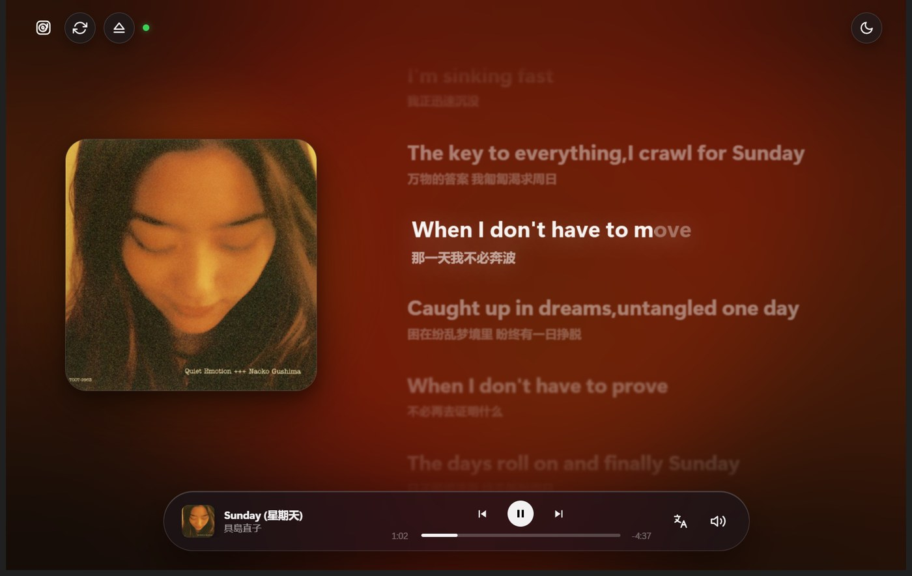
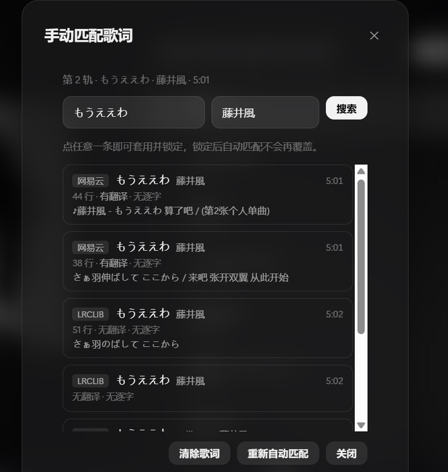
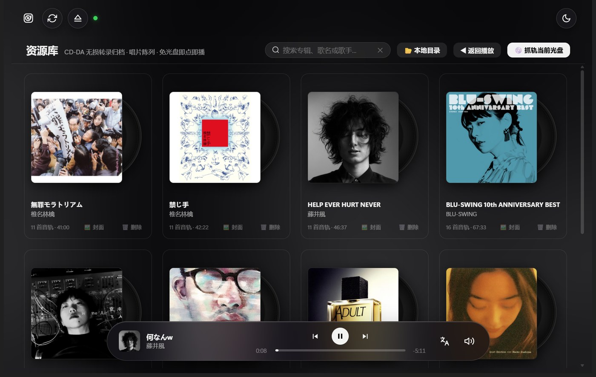

# Discflow

> **把 CD 重新放回桌面。**
>
> 一个为 Windows 打造的 Hi-Fi CD 音乐播放器 —— 光驱直读、双语逐字歌词、无损转录归档。


[](#系统要求)
[](https://www.python.org/)
[](LICENSE)
[](#测试)



---

## 这个项目解决什么问题

流媒体把音乐变成了「无限供给」，代价是你不再完整地听完一张唱片，也再没有「放进去、按下播放」这个动作。

而想把 CD 重新用起来，现有的方案都不太顺手：

| 痛点 | 现状 |
|---|---|
| **想听就要先转** | 主流工具（EAC、dBpoweramp、foobar2000）都要求先整张抓轨成文件，才能播放。想听一首歌，得先等十分钟 |
| **音质不透明** | 抓轨参数（偏移校正、C2 纠错、是否重采样）藏在深层设置里，大多数人不知道自己转出来的到底是不是无损 |
| **元数据认不出来** | 冷门碟、日版碟、自刻碟的 CD-TEXT 经常是空的，MusicBrainz 也查不到，最后显示一堆 `Track 01` |
| **没有歌词** | 桌面播放器对中日文歌词的支持基本为零，更别说双语对照和逐字时间轴 |
| **界面停留在 2005 年** | Winamp 式的皮肤、树状播放列表、密密麻麻的按钮 |

**Discflow 的思路是：先让你听得起来，再让你留得下来。**

- 插盘即播 —— 用 Win32 的光驱指令直接读 CDDA 原始扇区，边读边放，不落盘、不转码
- 想归档时再无损转录 —— 逐扇区转成 WAV，连同封面、曲目、歌词一起存进资料库
- 元数据三源并发 + 乱码治理 —— 冷门碟也能对上，脏数据不写进库
- 双语逐字歌词 —— 原文、译文双行，跟着播放头一个字一个字点亮

---

## 主要功能

### 🎧 光驱硬件直读

- 基于 Win32 `IOCTL_CDROM_READ_TOC` / `IOCTL_CDROM_RAW_READ` 直接读取 CDDA 扇区，`winmm.dll` 的 waveOut 输出
- **自适应扇区批次**：64 → 48 → 32 → 27 → 16 自动降级，外置 USB 光驱带宽不足时也不会断音
- 放盘、退盘、托盘就绪状态实时感知
- 优先读取碟片自带的 CD-TEXT，读不到再联网匹配

### 📝 双语逐字歌词

- 三源取词：**网易云**（译文 + 逐字）、**QQ 音乐**（中文曲库）、**LRCLIB**（欧美）
- 每一行拆成词块，按音节长度分配时长，逐字点亮
- 原文 + 译文双行对齐，当前句放大发光，其余柔焦虚化
- 专辑匹配时顺手记下每首歌的歌曲 ID，之后整张碟按 ID 直取，11 首约 8 秒跑完
- 对不上的曲目会在曲目行标记，可逐轨手动指定来源



### 💾 资料库归档

- 逐扇区无损转录为 WAV（16-Bit / 44.1 kHz 立体声），附封面与元数据
- 四列唱片货架网格，封面后透出黑胶
- 支持按专辑名 / 歌名 / 歌手实时搜索
- 整库 ZIP 导出导入，换台电脑解压即用



### 🔍 元数据匹配与清洗

- **MusicBrainz DiscID** 精确匹配，TOC 时长加权兜底，另有 GNUDb / FreeDB 备选
- 匹配失败时，QQ 音乐 / iTunes / 网易云三源并发检索候选，手动挑一条套用整张
- **乱码治理**：识别 Shift-JIS 误解码产生的残次条目（例如把「ー・ママ」错成「蕙」），自动排到最后，绝不写进资料库
- 弱网自愈：元数据超时自动重试一次，封面图床抖动会后台补抓

### 🎨 视觉与交互

- **环境光背景**：从封面提取主色，生成缓慢流动的弥散光斑
- **深浅双主题**：两套完整配色，不是简单反色
- 悬浮玻璃 Dock：封面、曲目、进度、音量一体
- 纯黑白 SF Symbols 风格内联 SVG 图标

---

## 安装与使用

### 系统要求

| | |
|---|---|
| 操作系统 | Windows 10 / 11（64 位） |
| 运行时 | [WebView2 Runtime](https://developer.microsoft.com/microsoft-edge/webview2/)（Win11 自带；Win10 若缺失需安装） |
| 光驱 | 内置或外置 USB CD-ROM（仅播放 CD 时需要；只播资料库则不需要） |

### 方式一：直接下载打包好的 EXE

到 [**Releases**](https://github.com/JiAng10es/Discflow/releases/latest) 下载 `Discflow.exe`，双击即可。

免安装、不写注册表、不驻留后台，删掉文件即卸载。

### 方式二：源码运行

```bash
git clone https://github.com/JiAng10es/Discflow.git
cd Discflow/win-cd-player

pip install -r requirements.txt
python main.py
```

### 方式三：自己打包

```bash
cd win-cd-player
pyinstaller --noconfirm Discflow.spec
# 产物在 dist/Discflow.exe
```

### 怎么用

1. **放一张 CD 进光驱** —— 程序会自动读取曲目、匹配封面和歌词，然后开始播放
2. **想归档就点「抓轨当前光盘」** —— 逐扇区转录成 WAV，存进 `library/`，之后不用插盘也能听
3. **右上角切换深浅主题**，左上角进入资料库
4. **歌词对不上？** 在曲目行点「词」按钮，手动从候选里挑一条

> 首次匹配封面和歌词需要联网。断网也能正常播放，只是没有封面和歌词。

---

## 项目目录结构

```
Discflow/
├── README.md                     本文件
├── LICENSE                       CC BY-NC 4.0
├── .gitignore
├── PRD.md                        产品需求文档（含 2.0 全量设计与踩坑记录）
├── docs/
│   └── screenshots/              README 用截图
│
└── win-cd-player/                程序本体
    ├── main.py                   主程序：控制器 + 内联 UI（HTML / CSS / JS）
    ├── cd_engine.py              Win32 光驱读取、TOC 解析、waveOut 播放
    ├── library_service.py        资料库扫描、抓轨、偏好持久化
    ├── metadata_service.py       元数据 / 封面 / 歌词 / 专辑候选检索
    ├── Discflow.spec             PyInstaller 打包配置
    ├── requirements.txt
    ├── discflow.ico
    ├── docs/discflow-icon.svg
    └── test_*.py                 163 项自动化测试
```

**运行时目录**（不在版本库里，由程序自动生成）：

```
Discflow.exe
├── library/                     唱片资料库，每张专辑一个子目录
│   └── <disc_id>/
├── preferences.json             音量、主题、底栏外观等偏好
```

---

## 输入与输出示例

Discflow 有两种「输入」：**一张物理 CD**，或者**一个已经存在的资料库目录**。

### 输入 A：物理音频 CD

程序通过 `IOCTL_CDROM_READ_TOC` 拿到碟片的 TOC（Table of Contents），其中包括：

- 每首曲目的起始 LBA、时长
- 碟片总长度
- 可选的 CD-TEXT（专辑名、艺术家、曲名）
- 由 TOC 计算出的 **MusicBrainz DiscID**（用于联网匹配）

```
G:  →  11 首音轨 / 总长 46:37 / CD-TEXT: 无
     DiscID: Oy_zcAkOjOx4tjetoyfdqY8kTKw-
```

### 输出：资料库目录

点「抓轨当前光盘」后，会产出这样的结构：

```
library/
└── Oy_zcAkOjOx4tjetoyfdqY8kTKw-/
    ├── album.json          元数据 + 曲目表 + 歌词（JSON）
    ├── cover.jpg           专辑封面（多源择优）
    ├── cover.png           原图（若来源为 PNG）
    ├── track_01.wav        逐扇区无损转录
    ├── track_02.wav
    └── ... track_11.wav
```

单个专辑目录约 **470 MB**（11 首曲目）。WAV 参数固定为：

| 参数 | 值 |
|---|---|
| 声道 | 2（立体声） |
| 位深 | 16 Bit |
| 采样率 | 44100 Hz |
| 压缩 | 无（PCM） |

### `album.json` 结构

```jsonc
{
  "disc_id": "Oy_zcAkOjOx4tjetoyfdqY8kTKw-",
  "title": "HELP EVER HURT NEVER",
  "artist": "藤井風",
  "year": "2020",
  "cover_file": "cover.png",
  "cover_data_url": "data:image/png;base64,iVBORw0KGgo...",   // 内嵌封面，供离线渲染
  "ripped_at": 1793611059.523528,                              // Unix 时间戳
  "tracks": [
    {
      "track_number": 1,
      "title": "何なんw",
      "artist": "藤井風",
      "duration_sec": 320.64,
      "file_name": "track_01.wav",
      "lyrics": [
        { "time": 0.0, "text": "作词 : 藤井風", "translation": "" },
        { "time": 12.4, "text": "何なんw", "translation": "怎么了呢" }
      ],
      "lyrics_source": "netease",       // netease / qq / lrclib / 空
      "lyrics_song_id": "1901371647",   // 来源站点上的歌曲 ID
      "lyrics_locked": false,           // true = 用户手动指定，不再自动覆盖
      "lyrics_matched_at": 0.0
    }
  ]
}
```

> `album.json` 是资料库扫描的**唯一判据** —— 没有这个文件的目录不会被识别为专辑。

### 输入 B：已有的资料库目录

把上面那个 `library/` 整个拷到任意位置，程序就能直接播放，不需要光驱。

默认查找顺序：

1. 环境变量 `DISCFLOW_LIBRARY` 指定的路径
2. 程序同级的 `library/`
3. 用户目录下的兜底位置

### 输出：偏好设置

```jsonc
// preferences.json
{
  "lyricLineHeight": 1.4,
  "lyricLetterSpacing": 0,
  "dockWidth": 720,
  "dockOpacity": 75,
  "dockBlur": 40,
  "themeMode": "dark",
  "volume": 80,
  "playMode": "loop",
  "showTranslation": true,
  "autoPlay": true
}
```

---

## 技术实现

| 层 | 技术 |
|---|---|
| 界面 | 原生 HTML / CSS / JavaScript，跑在 WebView2（pywebview）里 |
| 音频引擎 | Python `ctypes` 直接调 Win32 API：`kernel32.DeviceIoControl` + `winmm.waveOut*` |
| 元数据 | `requests` 并发请求 MusicBrainz / Cover Art Archive / QQ 音乐 / iTunes / 网易云 / LRCLIB |
| 打包 | PyInstaller onefile |

几个值得一提的实现细节：

- **边读边播**：读盘线程持续把 CDDA 扇区解码成 PCM 塞进 waveOut 缓冲，播放头与读盘位置解耦，因此可以任意 seek
- **自适应批次**：外置 USB 光驱在连续大块读取时会返回 `ERROR_NOT_READY`，程序会逐级缩小每次读取的扇区数重试
- **歌词缓存**：进程内 LRU 缓存，上限 400 条，避免长时间运行内存增长
- **封面主色提取**：从封面采样主色，生成 CSS 径向渐变叠层，切换专辑时整体换色

代码规模约 **11,500 行**（`main.py` 8,100 行，含内联 UI 模板）。

---

## 测试

```bash
# 在仓库根目录执行
python -m unittest discover -s win-cd-player -p "test_*.py"
```

```
Ran 163 tests in 1.25s

OK
```

测试覆盖：

- 光驱 TOC 解析与 DiscID 计算
- 资料库扫描、抓轨流程、ZIP 导入导出
- 元数据匹配、乱码识别、歌词缓存上限
- UI 结构完整性（元素存在性、无重复 ID、无死链）
- 偏好持久化、便携路径解析

测试会自动把资料库重定向到临时沙箱，**不会碰你的真实数据**。

---

## 已知限制

- **仅支持 Windows** —— 底层依赖 `IOCTL_CDROM_RAW_READ` 和 `winmm`，没有跨平台计划
- **需要物理光驱** —— 播放 CD 的前提；纯资料库播放不需要
- **冷门碟可能匹配不到** —— 依赖公开曲库，自刻碟、小众发行版经常查不到，此时会显示 `Track 01` 之类的兜底名
- **杀毒软件误报** —— PyInstaller 单文件打包的常见现象，加白名单即可
- **不支持 CD 以外的音源** —— 这是刻意的：它是一台 CD 播放器，不是通用音乐播放器

---

## 参与贡献

欢迎提 Issue 和 PR。提交前请确保：

1. `python -m unittest discover -s win-cd-player -p "test_*.py"` 全部通过
2. 新增功能同步更新 `PRD.md`
3. 不要提交 `library/`、`*.wav`、`*.exe` 或任何个人偏好文件

---

## 许可证

本项目采用 **[CC BY-NC 4.0](LICENSE)** 协议授权。

- ✅ 允许自由分享、修改、复制，并在个人非商业环境下使用
- ❌ **禁止任何形式的商业使用**（包括付费销售、捆绑分发、SaaS 化）

请注意这不是一个 OSI 认可的开源许可证 —— 它禁止商业用途。

所有音乐、封面与歌词的版权归各自权利人所有。本软件仅用于播放你合法拥有的唱片，不提供任何内容下载能力。

---

---

**唱片还在，声音也应该在。**
